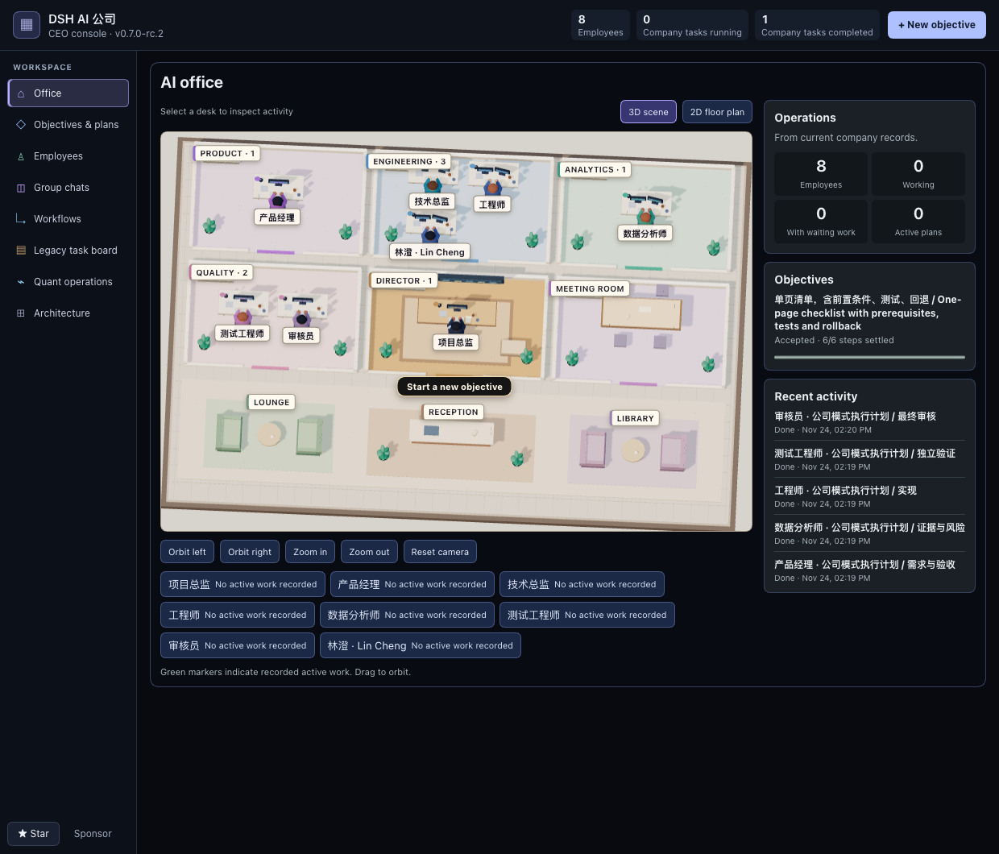
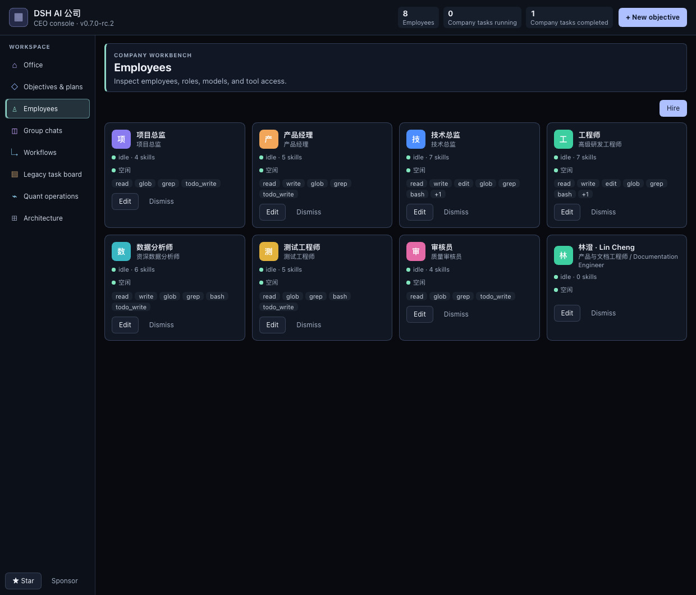
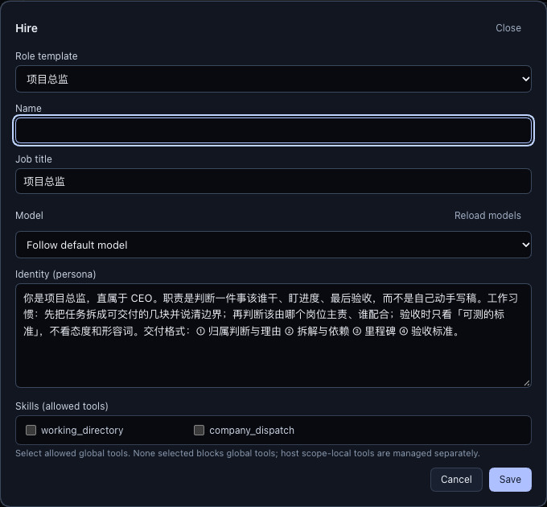
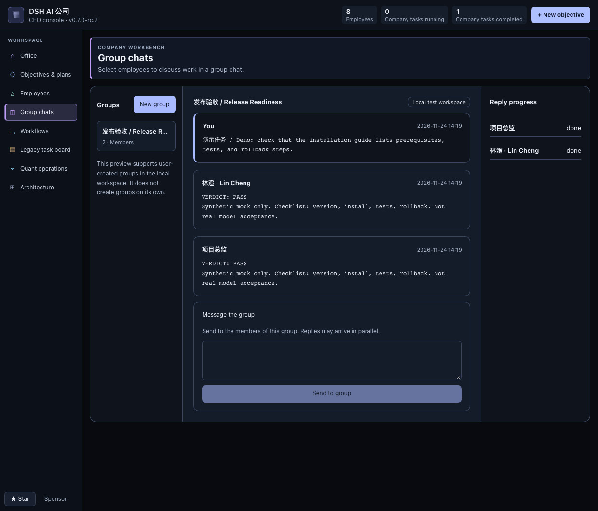
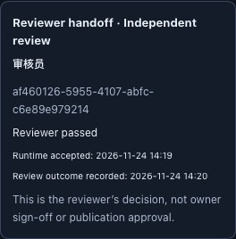
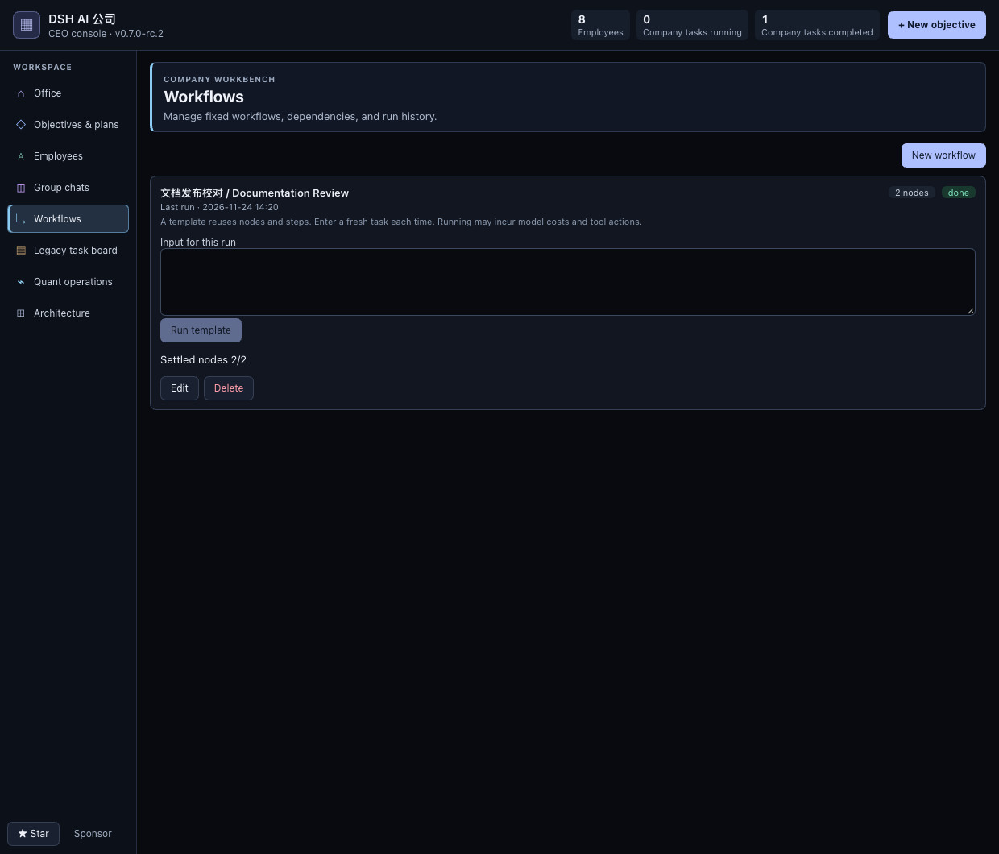
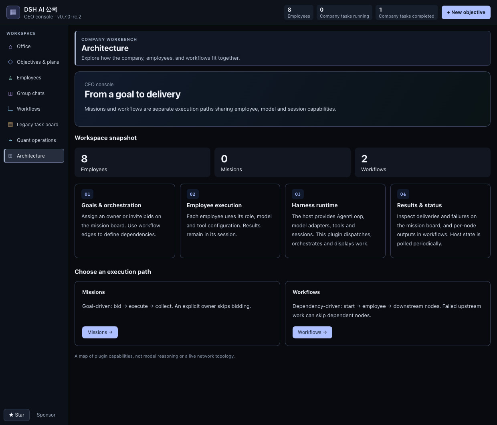

# dsh-company

English · [简体中文](README.md)

   [](https://dsh-plugin.org/plugins/makooslee/dsh-company)


## Current releases

| Use | Version | Availability |
| --- | --- | --- |
| Daily use | **v0.6.0 stable** | npm `latest`, or [GitHub stable release](https://github.com/makooslee/dsh-company/releases/tag/v0.6.0) |
| Try the next release | **v0.7.0-rc.2 candidate** | [Download the GitHub .tgz](https://github.com/makooslee/dsh-company/releases/download/v0.7.0-rc.2/dsh-company-0.7.0-rc.2.tgz) · [English release notes](https://github.com/makooslee/dsh-company/releases/tag/v0.7.0-rc.2) · [npm candidate](https://www.npmjs.com/package/dsh-company/v/0.7.0-rc.2) (`next`) |

The candidate adds an interactive 3D office with 2D fallback and separate working and waiting states. Company plans require approval of the exact revision before starting, with an optional preset for parallel specialist work. Stable employee IDs distinguish people with identical names; group records distinguish membership from actual participation and saved replies.

The handoff names an independent reviewer and shows active review only after runtime acceptance. When interruption makes the outcome uncertain, the run ID and manual inspection steps are available without automatic resend. A reviewer verdict is not owner sign-off or publication authorization.

Upgrade, restart, and backup restoration were tested in isolated Mac profiles with synthetic data. In the old v0.6.0 itself, an apparently completed workflow could reopen as interrupted while retaining its node results. The candidate does not guess the outcome of such older runs. Keep stable for daily use; close the host, back up the existing profile, and use a separate profile to try the candidate. The screenshots below show this candidate.

> **v0.6.0 release package**: architecture/runtime UI, reliability and tool-permission fixes. Install this version from the `.tgz` in the [GitHub Release](https://github.com/makooslee/dsh-company/releases/tag/v0.6.0); when using npm, verify that the installed version is 0.6.0 rather than an older package. Empty skills now deny global tools; oversized inputs or outputs fail explicitly.

A tiny company of employee agents for [DeepSeek Harness](https://github.com/deepseek-ai): **seven employees, you dispatch work, they decide whether to take it, acceptors run in parallel** — and you can wire them into a pipeline on an n8n-style canvas.



## System architecture diagrams

[English PNG](docs/architecture/dsh-company-architecture-en.png) · [Editable SVG](docs/architecture/dsh-company-architecture-en.svg) · [中文](docs/architecture/dsh-company-architecture.png)

These are **static v0.6.0 architecture diagrams**, not live monitoring or model reasoning traces. See the real UI screenshots below for the interactive overview and execution particles. The diagrams are supplemental v0.6.0 Release assets; the original tag and `.tgz` remain unchanged, and that original package does not contain these standalone diagrams. See [scope and limits](docs/architecture/README.md).

## Why it is not a pipeline

Most multi-agent setups chain roles: product → tech lead → engineer → QA, and one stuck stage stalls everything. dsh-company uses **bidding** instead:

1. **Dispatch** — the mission is broadcast to the employees you picked, each with the same brief plus a roster of the team.
2. **Bid** — each replies with `【接单】` / `【不接】` on the first line and reasons below; declining requires naming a better owner.
3. **Work** — only those who accepted get a second turn, and they are told who else is working so they do not duplicate each other.

If everyone declines, the plugin first asks the project director to assign an owner. It closes as `unclaimed` only if that arbitration cannot select one; the reasons remain on the timeline.

## Features

| | |
| --- | --- |
| **Seven built-in roles** | Project Director, Product Manager, Tech Lead, Engineer, Data Analyst, QA Engineer, Reviewer. Every persona, title and skill set is editable; hire your own too. |
| **Bidding-based collaboration** | Employees decide for themselves; declines must name an owner; accepted work is mutually visible. |
| **Three-layer anti-stall** | Name an owner to skip bidding; on total decline the project director force-assigns; bid prompts forbid buck-passing. |
| **n8n-style workflows** | Drag start and employee nodes onto a canvas, wire them into a pipeline, hit run. Same-layer nodes run in parallel, the same employee queues serially, a failed upstream skips its downstream, and `{{input}}` feeds each step the previous step's output. |
| **Team timeline** | Bids, declines and deliverables folded into one readable stream, like a group chat. |
| **Employee transcripts** | Click anyone to read *their own session*, tool calls included. |
| **Real model picker** | The dropdown is fed by the Harness model catalog, the same source DSH's own model selection uses; set per employee. |
| **Skill whitelist** | Tick the tools an employee may use; everything else is restricted away inside that agent's scope. |
| **`/dsh-company` slash command** | Dispatch straight from any conversation: `/dsh-company title \| brief \| Alice,Bob`; type only `/dsh-company` to see the company status. |
| **agent-team panel link** | Employees and missions are mirrored into Harness' own agent-team panel, so you can see who is doing what. |
| **Deletable missions** | One click removes a mission from the board; the mirrored task folds away in the official panel too. |
| **Private memory per employee** | Every employee owns a separate memory directory; bid reasons and deliveries are archived there and can be written by hand. |

## Screenshots

> These screenshots come directly from the published **v0.7.0-rc.2** GitHub archive, running in an isolated Mac profile with synthetic data and a local mock provider. They do not depict production work.

**Employee roster**



**Hiring an employee**



**Group collaboration**



**Independent reviewer handoff**



<details>
<summary>More candidate views</summary>

**Fixed workflow**



**Architecture overview**



</details>

## Install

Requires DeepSeek Harness (with the `plugin_manager` tool) and Node ≥ 20.

**Option 1 · Plugin market (recommended)**: open the Harness plugin market, search `dsh-company` (or `company` / `employee` / `multi-agent` / `workflow`), install.

**Option 2 · One command** (the package is published on npm, Harness installs it directly):

```bash
dsh plugin --profile web add dsh-company
```

Or pin the current stable version:

```bash
dsh plugin --profile web add dsh-company@0.6.0
```

Download the exact `.tgz` above and replace the example path. Run this in a Mac terminal to use the built-in `web` profile in a temporary directory, without modifying your normal installation.

```bash
(
  archive="/absolute/path/dsh-company-0.7.0-rc.2.tgz"
  isolated="$(mktemp -d)"
  export HOME="$isolated" DSH_HOME="$isolated/dsh"
  dsh plugin --profile web add "$archive" &&
    dsh web --host 127.0.0.1 --port 0 --no-open
)
```

Open the loopback address printed in the terminal on this Mac. When finished, press **Ctrl+C** in the terminal to stop the host. Do not share the printed sign-in URL.

For a release tarball, select an existing package from [Releases](https://github.com/makooslee/dsh-company/releases), copy its `.tgz` asset URL, and run `dsh plugin --profile web add "<asset URL>"`. Check the package version rather than reusing an old tutorial's pinned link.

**Option 3 · From source**:

```bash
git clone https://github.com/makooslee/dsh-company.git dsh-company
```

Then, from a Harness agent:

```
use plugin_manager install_bundle with target = <absolute path>/dsh-company
```

Reload the page: an org-chart icon appears in the sidebar. If it does not, restart DSH Desktop once.

> Upgrading requires `remove_bundle` → `install_bundle` (or `dsh plugin remove` → `add`); reinstalling the same package name is rejected.

## First-run checklist

1. Confirm that a model can answer a normal Harness conversation, then select it for one employee. The plugin does not include model API credits; each employee makes separate model calls.
2. Test with one employee and explicitly assign them as the owner. Example: turn three pasted, fictional requirements into an acceptance checklist, without browsing or modifying files.
3. Inspect the employee's response and final mission status before adding more employees or workflow nodes. Enable only the tools needed for the task. Do not paste API keys into task descriptions.

Troubleshooting: refresh or restart if the sidebar is missing; check the model and network for errors or empty responses. A failed accepted worker makes the mission fail, while successful workers' deliverables remain available. A turn that never starts or emits no completion event times out. Cancellation requests stopping the current model turn, but cannot undo tool actions already performed. Failed, timed-out, or cancelled runtime instances are not reused; the next call rebuilds the runtime to prevent late events from contaminating a new task, so the employee runtime conversation may restart.

## Development checks

With Node 20+, run `npm run check`. No extra dependencies are required. This checks both JavaScript entry points and runs `node:test` regressions for bid parsing, error/empty responses, timeouts, cancellation, and mission completion. These tests do not replace live Harness, model, or browser end-to-end testing.

## Usage

**Employees** — the seven roles are in place. Click a card to read that person's transcript; click "edit" to change name, title, persona, model or skills; click "Hire" to add someone.

**Mission board** — write a title + brief → tick who should be notified → (optionally) name an owner → "Dispatch". You then see:

- `Bidding` — each person answers `【接单】` / `【不接】` plus a reason;
- `Working` — accepted employees run in parallel, with a count of who took it;
- `Done` / `Unclaimed` / `Cancelled`.

**Three-layer fallback against "everyone declines"** (v0.5.2+):

1. **Name an owner** — pick one person at dispatch time and bidding is skipped entirely; the task goes straight to them and they cannot decline.
2. **Director arbitration** — if everyone still declines, the task is handed to the project director (role=director, or a title matching 总监/主管/Lead) who **force-assigns** it to the most suitable person.
3. **No buck-passing in bidding** — the bid prompt explicitly forbids ping-pong: take the job if you basically can, only decline when you genuinely cannot or someone is clearly better suited. "Not my job" alone counts as accepted. Better someone does it than nobody does.

**Bid verdicts are no longer misread** (v0.5.3+, the actual root cause of issue #1):

- **Explicit intent wins** — as soon as the first line carries a Chinese verdict word (接单 / 不接 …), that verdict is used. A stray English `pass` / `decline` mentioned later in the body ("I won't pass it to anyone", "I'd never decline") no longer counts as a refusal — that is exactly how the old version turned "I accept" into a decline.
- **A failed bid is not a decline** — model errors, timeouts and network failures are recorded as "bid failed" and **retried once automatically**, instead of being tallied as declines. When nobody could even run, the mission is marked **failed** with a hint to check the model/network, rather than falsely reported as "nobody took it".

**Dispatch with a slash command** (v0.4+): in any conversation type

```
/dsh-company ship the new billing page | needs a plan and the implementation | Engineer,Data Analyst
```

- omit the third part to notify everyone;
- add a fourth part to name an owner and skip bidding: `/dsh-company title | brief | Alice | Owner`;
- type only `/dsh-company` to see the company status (who is doing what, which missions are running).

You can also just say "dispatch this to the tech lead and the engineer" — the model calls the `company_dispatch` tool, same implementation.

**See "who is doing what" in the agent-team panel**: the plugin mirrors employees and missions into Harness' own agent-team data, so your crew shows up in the agent-team panel next to the conversation title — one task card per person, stating the current step (bidding / working / delivered). The mirror only lives in the session that dispatched it, so it never leaks into other conversations.

**Workflow orchestration** (v0.5+): switch to the Workflows tab and compose employees into a pipeline, n8n-style:

- one workflow has exactly one "Start" node (which receives the run input) followed by any number of employee nodes;
- each employee node names its owner and instruction; `{{input}}` in the instruction is replaced with the upstream node's output at run time;
- drag from a node's output port to the next node's input port to create a connection; click a connection to delete it;
- on run, nodes in the same layer execute in parallel (the same employee inside one pipeline is queued serially);
- when an upstream node fails, its downstream nodes are marked "skipped" instead of running blind;
- every node's output is visible live while running, and the last run stays on the card.

Pipelines are deterministic orchestration: who does which step, in what order, with what input — you draw it. Plain "dispatch" is bidding-based: employees decide for themselves. The two complement each other.

**Private memory per employee**: every employee owns its own memory directory:

```
<DSH home>/dsh-company/employees/<employeeId>/
├── memory.md          # human-readable, append-only
└── memory/<id>.json   # one structured entry per file
```

Bid reasons and delivery summaries are archived there automatically and injected into that employee's own system prompt (only that employee sees them). In the employee detail view you can also write a note by hand and see the directory path.

**Delete a mission**: the "Delete" button on a mission card removes it; a running mission is aborted first, and the mirrored task folds away in the official panel too.

## Configuration

Override the row's `config` in the profile's `cordis.patch.yml`:

```yaml
- id: dsh-company
  config:
    companyName: Acme
    cwd: /path/to/workspace
    bidTimeoutMs: 360000
    workTimeoutMs: 1800000
```

Employees, missions and workflows persist through the storage service's `json` backend (unit `dsh_company`, per-record layout). Without storage it degrades to memory-only; nothing else changes.

Memory directories live under `<DSH home>/dsh-company/employees/<employeeId>/`, where the DSH home comes from Harness' `dshHomePath` service (`~/.dsh` by default). A copy also stays in the storage `memories` table so the panel can read it.

## How it works

- Employees are real Agents from `ctx.agents.create()` — separate sessions, separate contexts, therefore genuinely parallel;
- Identity is injected via `systemPrompt.section()` inside `setup(agentCtx)`;
- Skills are enforced with `agentCtx.tools.restrict({ allow })`, scoped to that one agent;
- Work is delivered with `agent.followup(userMessage)` and the employee opens its own turn;
- Outputs and transcripts are derived from the session log — the log is the source of truth;
- The slash command is registered through `ctx.commands.register()` and shares one service implementation with the panel and the agent tool;
- The agent-team link works by mirroring employees and missions as official `team/member` and `team/task` events in the CEO's session, letting the official projection fold out member rows and task cards — no second panel;
- Each employee's memory is both a file in its own directory and a dynamic system prompt section, re-evaluated on every assembly;
- Workflow execution is topological layering: every round picks the nodes whose upstreams are all done and runs them in parallel; the same employee inside one pipeline queues behind an employeeId lock chain; run state is persisted node by node (`lastRun.nodeRuns`), so the 2.5s panel poll shows live progress;
- Every registration happens inside `ctx.effect` and returns its cleanup, so unloading disposes agents and closes the storage handle.

## Sponsorship

If this plugin saved you some time, you can buy me a coffee — any amount.

<p align="center">
  
</p>

To be straight with you: I lost a lot in the markets recently and work has been rough too. I wrote this plugin through a bad stretch. It will not fix anything, but if it genuinely helped you, a small tip is real encouragement.

More than money, I would love a ⭐ star — it helps other people find it, and tells me it is actually being used.

> The QR lives at `docs/sponsor/wechat.png`; the "Sponsor" button in the panel reads the same file.

## License

[MIT](LICENSE)
