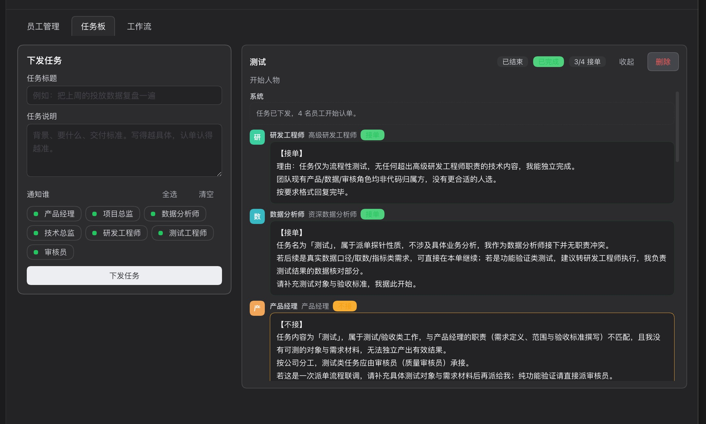
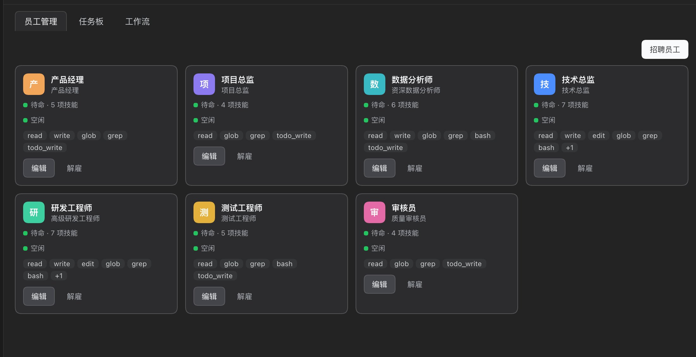
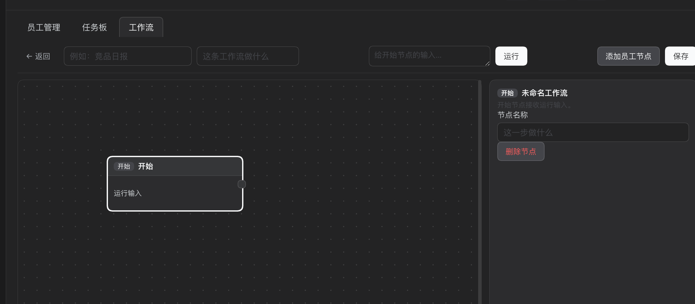
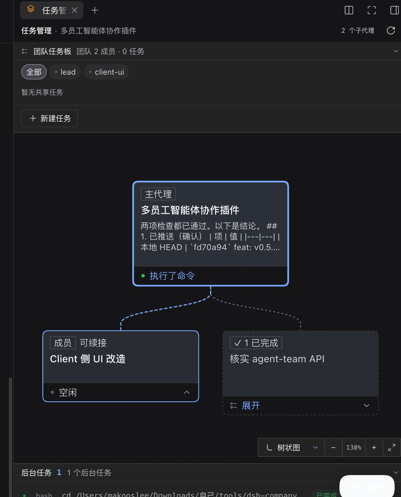
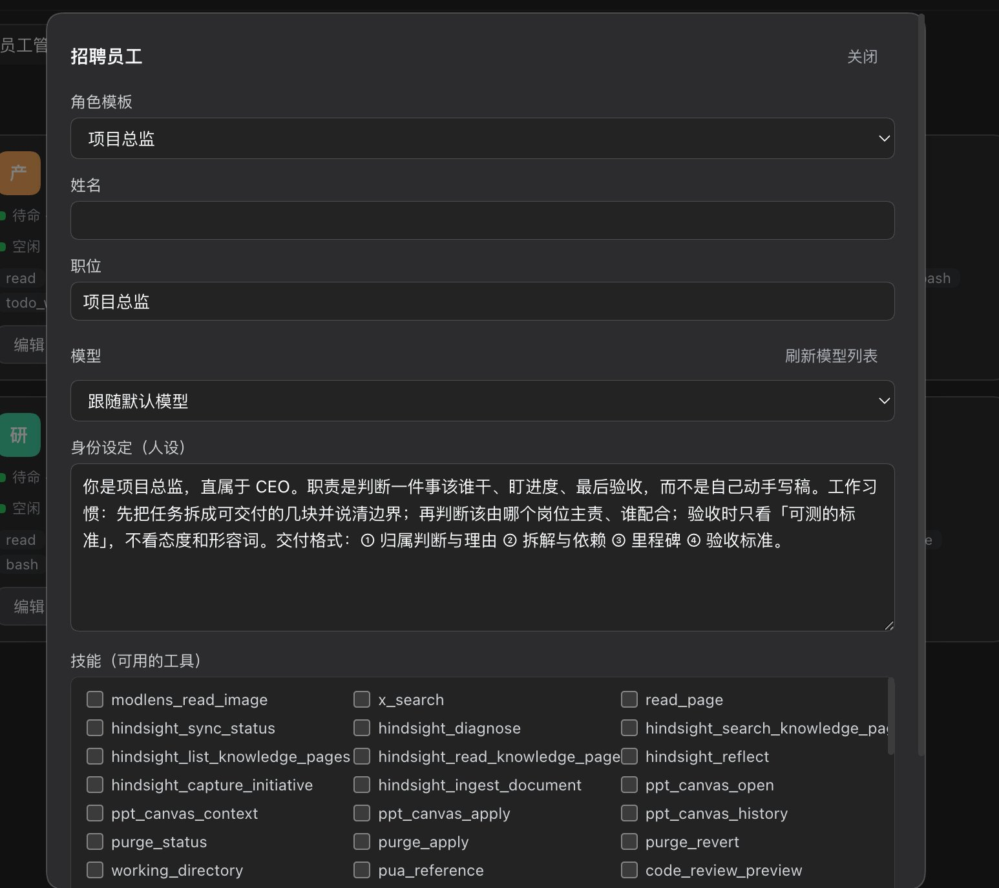

# dsh-company

English · [简体中文](README.md)

  

A tiny company of employee agents for [DeepSeek Harness](https://github.com/deepseek-ai): **seven employees, you dispatch work, they decide whether to take it, acceptors run in parallel** — and you can wire them into a pipeline on an n8n-style canvas.



The mission is broadcast, Engineering and Analytics accept and start working, Product declines and names the right owner — not a pipeline, a bidding market.

If it helps, a ⭐ star on the repo means a lot.

## Why it is not a pipeline

Most multi-agent setups chain roles: product → tech lead → engineer → QA, and one stuck stage stalls everything. dsh-company uses **bidding** instead:

1. **Dispatch** — the mission is broadcast to the employees you picked, each with the same brief plus a roster of the team.
2. **Bid** — each replies with `【接单】` / `【不接】` on the first line and reasons below; declining requires naming a better owner.
3. **Work** — only those who accepted get a second turn, and they are told who else is working so they do not duplicate each other.

"Nobody took it" is a legitimate outcome: the mission is closed as `unclaimed` with the reasons left on the timeline, instead of being forced onto someone.

## Features

| | |
| --- | --- |
| **Seven built-in roles** | Project Director, Product Manager, Tech Lead, Engineer, Data Analyst, QA Engineer, Reviewer. Every persona, title and skill set is editable; hire your own too. |
| **Bidding-based collaboration** | Employees decide for themselves; declines must name an owner; accepted work is mutually visible. |
| **n8n-style workflows** | Drag start and employee nodes onto a canvas, wire them into a pipeline, hit run. Same-layer nodes run in parallel, the same employee queues serially, a failed upstream skips its downstream, and `{{input}}` feeds each step the previous step's output. |
| **Team timeline** | Bids, declines and deliverables folded into one readable stream, like a group chat. |
| **Employee transcripts** | Click anyone to read *their own session*, tool calls included. |
| **Real model picker** | The dropdown is fed by the Harness model catalog, the same source DSH's own model selection uses; set per employee. |
| **Skill whitelist** | Tick the tools an employee may use; everything else is restricted away inside that agent's scope. |
| **`/dsh-company` slash command** | Dispatch straight from any conversation: `/dsh-company title \| brief \| Alice,Bob`; type only `/dsh-company` to see the company status. |
| **agent-team panel link** | Employees and missions are mirrored into Harness' own agent-team panel, so you can see who is doing what. |
| **Deletable missions** | One click removes a mission from the board; the mirrored task folds away in the official panel too. |
| **Private memory per employee** | Every employee owns a separate memory directory; bid reasons and deliveries are archived there and can be written by hand. |

## Screenshots

**Employees** — built-in roles in place; every card shows status and skills, click through for the full transcript



**Workflows** — an n8n-style canvas: drag nodes, connect ports, reference upstream output with `{{input}}`, then run — same-layer nodes execute in parallel



**agent-team link** — employees and missions mirrored into the official agent-team panel, one task card per person showing the current step



**Hire** — open a new seat from a role template; persona, model and skill whitelist are all editable



> Screenshots are from the Chinese UI; an English localisation ships in the same bundle.

## Install

Requires DeepSeek Harness (with the `plugin_manager` tool) and Node ≥ 20.

**Option 1 · Plugin market (recommended)**: open the Harness plugin market, search `dsh-company`, install.

**Option 2 · One command** (the package is published on npm, Harness installs it directly):

```bash
dsh plugin --profile web add dsh-company
```

Pin a version:

```bash
dsh plugin --profile web add dsh-company@0.5.0
```

Prefer the release tarball instead of the npm registry:

```bash
dsh plugin --profile web add "https://github.com/makooslee/dsh-company/releases/download/v0.5.0/dsh-company-0.5.0.tgz"
```

**Option 3 · From source**:

```bash
git clone https://github.com/makooslee/dsh-company.git dsh-company
```

Then, from a Harness agent:

```
use plugin_manager install_bundle with target = <absolute path>/dsh-company
```

Reload the page: an org-chart icon appears in the sidebar. If it does not, restart DSH Desktop once.

> Upgrading requires `remove_bundle` → `install_bundle` (or `dsh plugin remove` → `add`); reinstalling the same package name is rejected.

## Usage

**Employees** — the seven roles are in place. Click a card to read that person's transcript; click "edit" to change name, title, persona, model or skills; click "Hire" to add someone.

**Mission board** — write a title + brief → tick who should be notified → "Dispatch". You then see:

- `Bidding` — each person answers `【接单】` / `【不接】` plus a reason;
- `Working` — accepted employees run in parallel, with a count of who took it;
- `Done` / `Unclaimed` / `Cancelled`.

**Dispatch with a slash command** (v0.4+): in any conversation type

```
/dsh-company ship the new billing page | needs a plan and the implementation | Engineer,Data Analyst
```

- omit the third part to notify everyone;
- type only `/dsh-company` to see the company status (who is doing what, which missions are running).

You can also just say "dispatch this to the tech lead and the engineer" — the model calls the `company_dispatch` tool, same implementation.

**See "who is doing what" in the agent-team panel**: the plugin mirrors employees and missions into Harness' own agent-team data, so your crew shows up in the agent-team panel next to the conversation title — one task card per person, stating the current step (bidding / working / delivered). The mirror only lives in the session that dispatched it, so it never leaks into other conversations.

**Workflow orchestration** (v0.5+): switch to the Workflows tab and compose employees into a pipeline, n8n-style:

- one workflow has exactly one "Start" node (which receives the run input) followed by any number of employee nodes;
- each employee node names its owner and instruction; `{{input}}` in the instruction is replaced with the upstream node's output at run time;
- drag from a node's output port to the next node's input port to create a connection; click a connection to delete it;
- on run, nodes in the same layer execute in parallel (the same employee inside one pipeline is queued serially);
- when an upstream node fails, its downstream nodes are marked "skipped" instead of running blind;
- every node's output is visible live while running, and the last run stays on the card.

Pipelines are deterministic orchestration: who does which step, in what order, with what input — you draw it. Plain "dispatch" is bidding-based: employees decide for themselves. The two complement each other.

**Private memory per employee**: every employee owns its own memory directory:

```
<DSH home>/dsh-company/employees/<employeeId>/
├── memory.md          # human-readable, append-only
└── memory/<id>.json   # one structured entry per file
```

Bid reasons and delivery summaries are archived there automatically and injected into that employee's own system prompt (only that employee sees them). In the employee detail view you can also write a note by hand and see the directory path.

**Delete a mission**: the "Delete" button on a mission card removes it; a running mission is aborted first, and the mirrored task folds away in the official panel too.

## Configuration

Override the row's `config` in the profile's `cordis.patch.yml`:

```yaml
- id: dsh-company
  config:
    companyName: Acme
    cwd: /path/to/workspace
    bidTimeoutMs: 360000
    workTimeoutMs: 1800000
```

Employees, missions and workflows persist through the storage service's `json` backend (unit `dsh_company`, per-record layout). Without storage it degrades to memory-only; nothing else changes.

Memory directories live under `<DSH home>/dsh-company/employees/<employeeId>/`, where the DSH home comes from Harness' `dshHomePath` service (`~/.dsh` by default). A copy also stays in the storage `memories` table so the panel can read it.

## How it works

- Employees are real Agents from `ctx.agents.create()` — separate sessions, separate contexts, therefore genuinely parallel;
- Identity is injected via `systemPrompt.section()` inside `setup(agentCtx)`;
- Skills are enforced with `agentCtx.tools.restrict({ allow })`, scoped to that one agent;
- Work is delivered with `agent.followup(userMessage)` and the employee opens its own turn;
- Outputs and transcripts are derived from the session log — the log is the source of truth;
- The slash command is registered through `ctx.commands.register()` and shares one service implementation with the panel and the agent tool;
- The agent-team link works by mirroring employees and missions as official `team/member` and `team/task` events in the CEO's session, letting the official projection fold out member rows and task cards — no second panel;
- Each employee's memory is both a file in its own directory and a dynamic system prompt section, re-evaluated on every assembly;
- Workflow execution is topological layering: every round picks the nodes whose upstreams are all done and runs them in parallel; the same employee inside one pipeline queues behind an employeeId lock chain; run state is persisted node by node (`lastRun.nodeRuns`), so the 2.5s panel poll shows live progress;
- Every registration happens inside `ctx.effect` and returns its cleanup, so unloading disposes agents and closes the storage handle.

## Sponsorship

If this plugin saved you some time, you can buy me a coffee — any amount.

<p align="center">
  
</p>

To be straight with you: I lost a lot in the markets recently and work has been rough too. I wrote this plugin through a bad stretch. It will not fix anything, but if it genuinely helped you, a small tip is real encouragement.

More than money, I would love a ⭐ star — it helps other people find it, and tells me it is actually being used.

> The QR lives at `docs/sponsor/wechat.png`; the "Sponsor" button in the panel reads the same file.

## License

[MIT](LICENSE)
