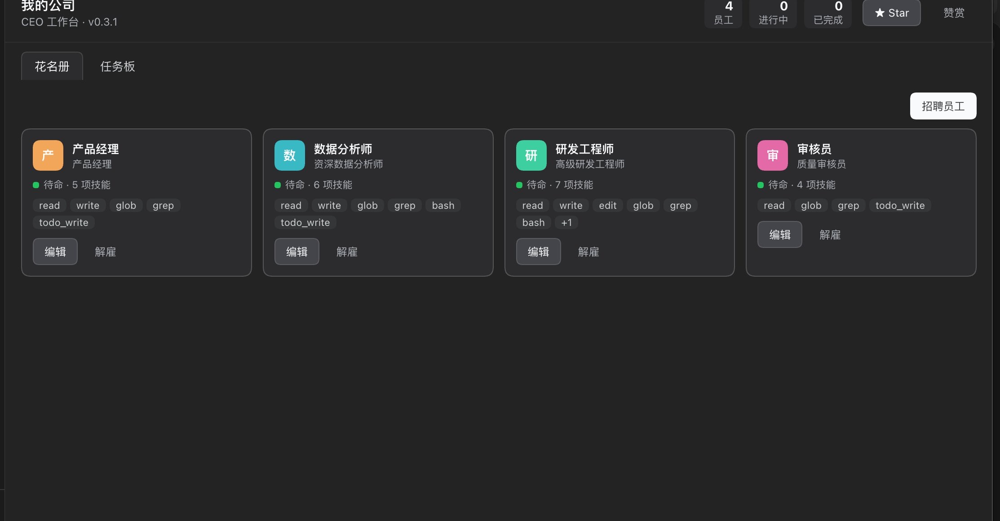
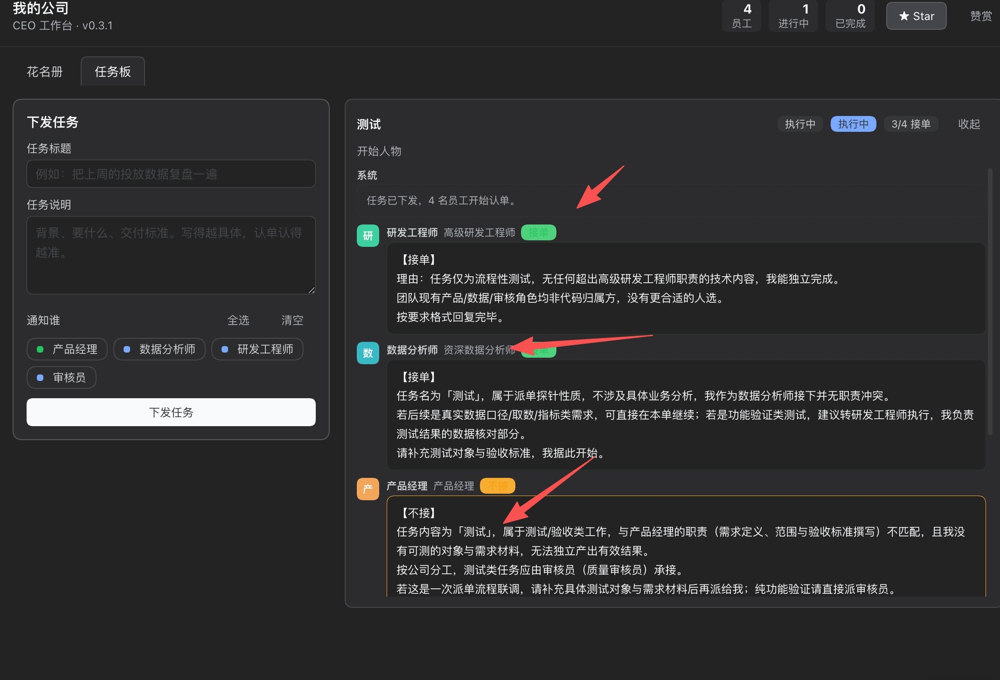
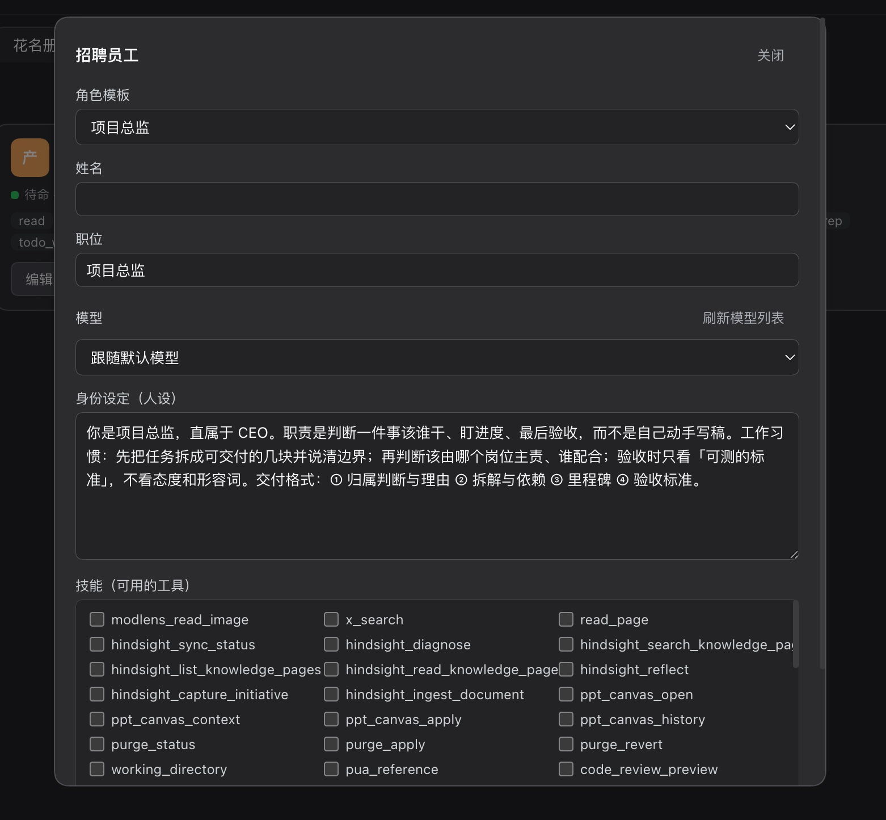

# dsh-company

[English](README.en.md) · 简体中文

给 [DeepSeek Harness](https://github.com/deepseek-ai) 装一家只有一位 CEO 的小公司。

如果它有用，欢迎给仓库点个 ⭐ Star——那比什么都管用。

你是 CEO。下面是一整个班底，每个员工**都是一个真实的智能体会话**，有自己的身份、自己的模型、自己的技能清单。你派活，他们**自己决定接不接**——接的人并行开工，不接的人要说明该谁接。整个过程汇成一条团队时间线，像一个群在开会，而不是一条流水线。

```
CEO 派单
   ├─ 项目总监   【接单】→ 拆解与验收标准
   ├─ 产品经理   【接单】→ 需求与验收口径
   ├─ 技术总监   【不接】→ 这属于产品范围，建议产品经理接
   ├─ 工程师     【接单】→ 实现与验证
   ├─ 数据分析师 【接单】→ 口径与数据
   ├─ 测试工程师 【接单】→ 用例与缺陷
   └─ 审核员     【接单】→ 挑毛病
```

## 它解决什么

多智能体最常见的做法是「流水线」：产品→技术→开发→测试，一环卡住全停。dsh-company 换成**认单制**：

1. **派单**：任务广播给被勾选的员工，每人拿到同一份任务 + 一份团队花名册。
2. **认单**：每人先回答「这活该不该我接」——第一行只能写 `【接单】` 或 `【不接】`，第二行起写理由；不接的人必须指出该谁接。
3. **执行**：只有接单的人进入第二轮，并且知道同期谁也在干（避免重复劳动）。

没人接单也是一个有效结果：任务会被标成 `没人接单`，理由留在时间线上，而不是硬塞给某个人。

## 功能

| | |
| --- | --- |
| **七个内置角色** | 项目总监、产品经理、技术总监、工程师、数据分析师、测试工程师、审核员；人设、技能、职位都可改，也可自己招聘新员工 |
| **认单制协作** | 员工自主判断接不接，不接要给出归属建议；接单者之间互相可见 |
| **团队时间线** | 认单、拒单、交付按时间汇成一条可读的流，像群聊一样 |
| **员工对话详情** | 点开花名册里的任何一个人，看**他自己那个会话**的完整对话（含工具调用） |
| **真实模型选择** | 模型下拉来自 Harness 的模型目录，和 DSH 自己的模型选择同源；可按员工单独指定 |
| **技能白名单** | 每个员工可用的工具逐项勾选，未勾选的工具在其 agent scope 内被限制掉 |
| **两种入口** | 管理页面派单；或在对话里直接用 `company_dispatch` 工具让 CEO 助手派单（同一份实现） |

## 效果图

**花名册** — 内置角色就位，卡片上直接看状态和技能，点开可看该员工的完整对话



**任务板** — 派单后员工自行认单：研发工程师、数据分析师接单，产品经理拒单并说明该归谁干



**招聘员工** — 从角色模板开新坑，人设、模型、技能白名单都能改



## 安装

要求：DeepSeek Harness（含 `plugin_manager` 工具）与 Node ≥ 20。

```bash
git clone <this-repo> dsh-company
```

然后让 Harness 里的 agent 执行：

```
用 plugin_manager 的 install_bundle，target 指向 <绝对路径>/dsh-company
```

或者自己调：

```json
{ "action": "install_bundle", "target": "/absolute/path/to/dsh-company" }
```

装完刷新页面，左侧栏出现**组织结构图图标**；点开就是公司面板。侧栏没出现图标就重启一次 DSH Desktop。

> 换版本要按 `remove_bundle` → `install_bundle` 的顺序走：同一个包名重复安装会被拒绝。

## 用法

**花名册**：七个角色已就位。点卡片看这个人的对话记录；点「编辑」改姓名、职位、人设、模型、技能；点「招聘员工」加人。

**任务板**：写标题 + 说明 → 勾选要通知谁 → 「下发任务」。随后你会看到：

- `认单中`：每个人在回复 `【接单】` / `【不接】` + 理由；
- `执行中`：接单的人并行干活，谁接了单在标题旁有计数；
- `已完成` / `没人接单` / `已取消`。

**从对话里派单**：直接说「把这事派给技术总监和工程师」，模型会调 `company_dispatch`。

## 配置

在 profile 的 `cordis.patch.yml` 里覆盖该行的 `config`：

```yaml
- id: dsh-company
  config:
    companyName: 我的公司        # 面板标题与人设里出现的公司名
    cwd: /path/to/workspace      # 员工会话的默认工作目录，留空用 Harness 默认
    bidTimeoutMs: 360000         # 单次认单超时（默认 6 分钟）
    workTimeoutMs: 1800000       # 单次执行超时（默认 30 分钟）
```

数据：花名册与任务存放于 storage 服务的 `json` 后端（unit `dsh_company`，per-record）。存储不可用时自动退化为纯内存，功能不变，只是重启后不保留。

## 实现要点

- 员工是 `ctx.agents.create()` 创建的真实 Agent，各自独立 session 与上下文，因此天然并行；
- 身份走 `setup(agentCtx)` 里的 `systemPrompt.section()`；
- 技能走 `agentCtx.tools.restrict({ allow })`，只作用于该员工自己的 agent scope；
- 派活走 `agent.followup(userMessage)`，员工自己开新 turn；
- 产出、对话记录都从 session 日志派生——日志是唯一真相源，插件内存只是派生缓存；
- 所有注册都在 `ctx.effect` 内完成并返回清理，插件卸载时释放 agent、关闭存储句柄。

## 目录

```
dsh-company/
├── index.js            Host 半身：花名册 / 认单调度 / HTTP API / agent 工具
├── client.js           浏览器半身：侧栏图标 + 公司面板（React，无 JSX）
├── cordis.patch.yml    bundle 挂载行
├── locale/             Plugin Manager 读取的标题与描述（zh / en）
├── icon.svg
└── docs/sponsor/       打赏二维码放这里（见该目录说明）
```

## 赞赏

如果这个插件替你省下了时间，可以扫码请我喝杯咖啡，金额随意。

<p align="center">
  
</p>

说句实话：最近投资亏了不少，工作上也接连不顺，这个插件是我在低谷里一行行写出来的。它不解决任何实际问题，但如果它真的帮到了你，一点支持对我是实实在在的鼓励。谢谢。

比起钱，我更想要一个 ⭐ Star——那能让更多人看到它，也能让我知道这东西有人用。

> 收款码放在 `docs/sponsor/wechat.png`；插件面板右上角的「赞赏」按钮读的是同一张图。

## 许可

[MIT](LICENSE)

## 致谢

- 插件形态、主题 token 与插槽机制来自 DeepSeek Harness 官方的 `cordis-plugin-development` 规范；
- 界面控件的视觉参照了 Harness 自带的 Plugin Manager / Settings 页面。
