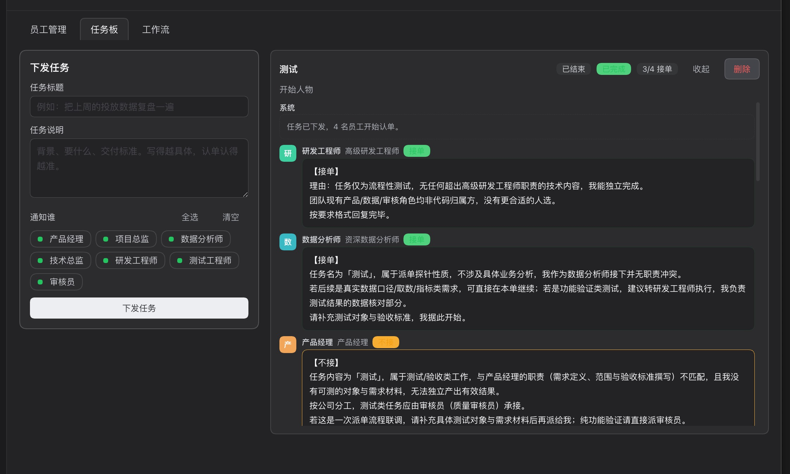
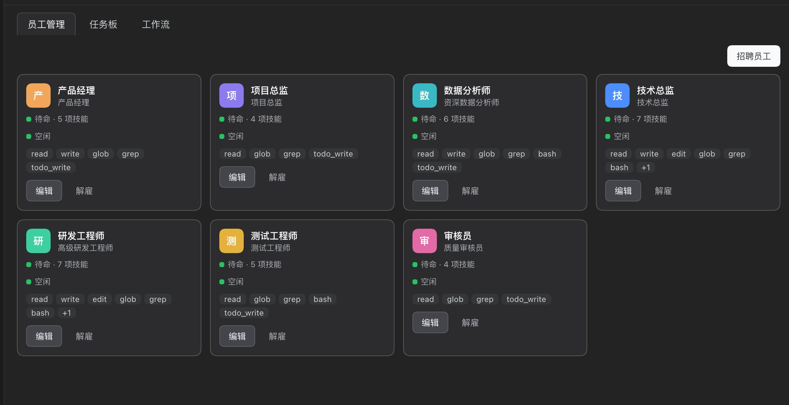
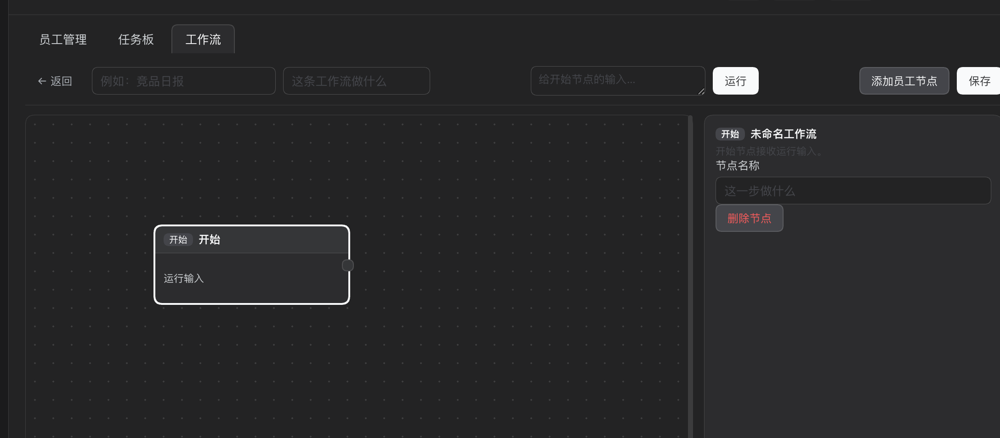
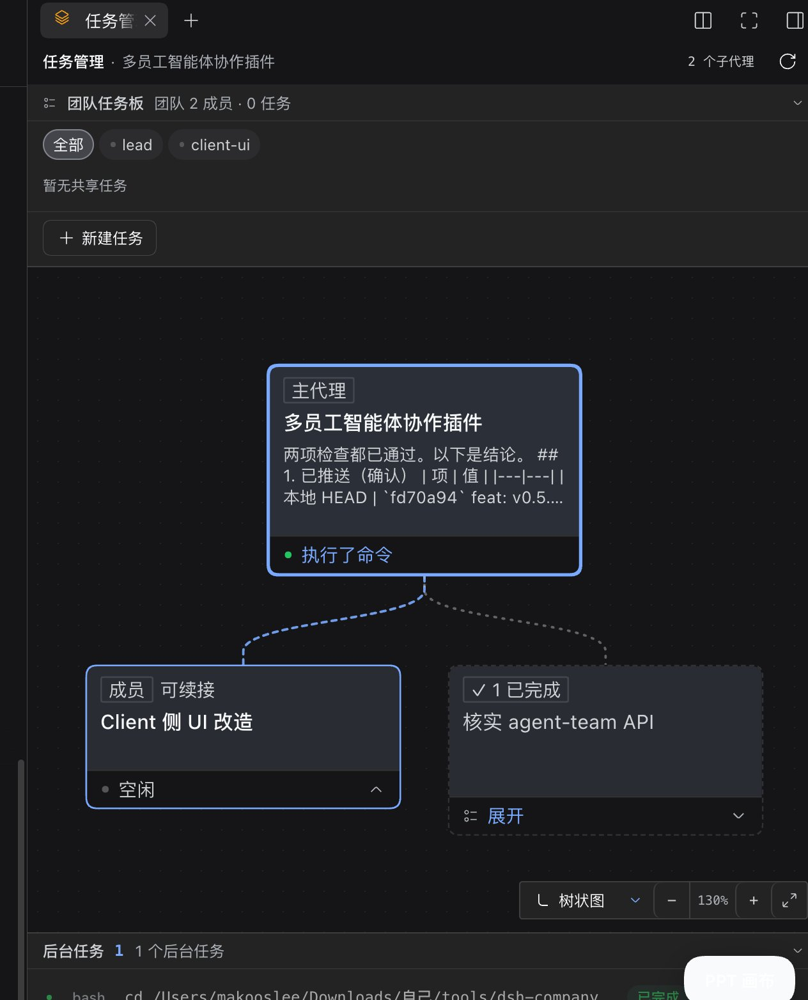
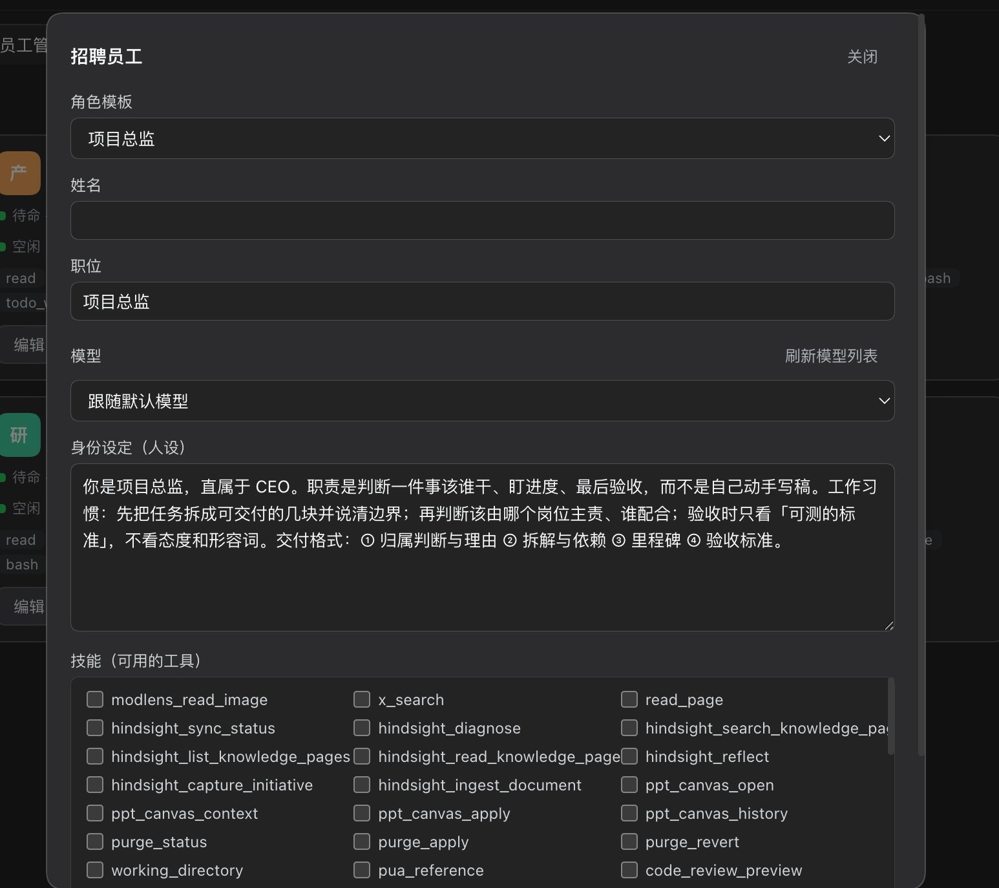

# dsh-company

[English](README.en.md) · 简体中文

  

给 [DeepSeek Harness](https://github.com/deepseek-ai) 装一家只有一位 CEO 的小公司：**七个员工智能体，你派活，他们自己决定接不接，接单的人并行开工**——还可以像 n8n 一样把员工排成工作流。



任务广播下去，研发和数据接单开工，产品经理拒单并指出该归谁干——不是流水线，是认单制。

如果它有用，欢迎给仓库点个 ⭐ Star——那比什么都管用。

## 它解决什么

多智能体最常见的做法是「流水线」：产品→技术→开发→测试，一环卡住全停。dsh-company 换成**认单制**：

1. **派单**：任务广播给被勾选的员工，每人拿到同一份任务 + 一份团队名册。
2. **认单**：每人先回答「这活该不该我接」——第一行只能写 `【接单】` 或 `【不接】`，不接的人必须指出该谁接。
3. **执行**：只有接单的人进入第二轮并行干活，并且知道同期谁也在干（避免重复劳动）。

没人接单也是一个有效结果：任务标成 `没人接单`，理由留在时间线上，而不是硬塞给某个人。

```
CEO 派单
   ├─ 项目总监   【接单】→ 拆解与验收标准
   ├─ 产品经理   【接单】→ 需求与验收口径
   ├─ 技术总监   【不接】→ 这属于产品范围，建议产品经理接
   ├─ 工程师     【接单】→ 实现与验证
   ├─ 数据分析师 【接单】→ 口径与数据
   ├─ 测试工程师 【接单】→ 用例与缺陷
   └─ 审核员     【接单】→ 挑毛病
```

## 功能

| | |
| --- | --- |
| **七个内置角色** | 项目总监、产品经理、技术总监、工程师、数据分析师、测试工程师、审核员；人设、技能、职位都可改，也可自己招聘新员工 |
| **认单制协作** | 员工自主判断接不接，不接要给出归属建议；接单者之间互相可见 |
| **n8n 式工作流** | 画布上拖「开始」+「员工」节点、拉连线成管线，一键运行；同层并行、同员工串行、上游失败下游自动跳过、`{{input}}` 把上一步输出喂给下一步 |
| **团队时间线** | 认单、拒单、交付按时间汇成一条可读的流，像群聊一样 |
| **员工对话详情** | 点开任何一个人，看**他自己那个会话**的完整对话（含工具调用） |
| **真实模型选择** | 模型下拉来自 Harness 的模型目录，和 DSH 自己的模型选择同源；可按员工单独指定 |
| **技能白名单** | 每个员工可用的工具逐项勾选，未勾选的工具在其 agent scope 内被限制掉 |
| **`/dsh-company` 斜杠命令** | 在当前对话框直接派活：`/dsh-company 标题 \| 说明 \| 员工A,员工B`；只写 `/dsh-company` 看公司现状 |
| **agent-team 面板联动** | 员工与任务镜像进 Harness 自带的 agent-team 面板，直接看到「谁在干什么」 |
| **任务可删除** | 任务卡上的删除按钮一键清理任务；官方面板里的镜像任务同步折叠 |
| **每员工独立记忆** | 每个员工一个独立目录存记忆，接单理由、交付结论自动归档，还能手动记一笔 |

## 界面

**员工管理** — 内置角色就位，卡片上直接看状态和技能，点开可看该员工的完整对话



**工作流** — n8n 式画布：拖节点、拉连线、`{{input}}` 串起上游产出，「运行」后同层并行执行



**agent-team 联动** — 员工与任务镜像进官方 agent-team 面板，每人一张任务卡写着当前进度



**招聘员工** — 从角色模板开新坑，人设、模型、技能白名单都能改



> 截图来自中文界面；英文本地化随包附带（[English](README.en.md)）。

## 安装

要求：DeepSeek Harness（含 `plugin_manager` 工具）与 Node ≥ 20。

**方式一 · 插件市场（推荐）**：打开 Harness 的插件市场，搜索 `dsh-company`，一键安装。

**方式二 · 一行命令**（包已发布到 npm，Harness 可直接装）：

```bash
dsh plugin --profile web add dsh-company
```

或指定版本：

```bash
dsh plugin --profile web add dsh-company@0.5.0
```

不想用 npm 源，就走 release tarball：

```bash
dsh plugin --profile web add "https://github.com/makooslee/dsh-company/releases/download/v0.5.0/dsh-company-0.5.0.tgz"
```

**方式三 · 源码安装**：

```bash
git clone https://github.com/makooslee/dsh-company.git dsh-company
```

然后让 Harness 里的 agent 执行：

```
用 plugin_manager 的 install_bundle，target 指向 <绝对路径>/dsh-company
```

装完刷新页面，左侧栏出现**组织结构图图标**；点开就是公司面板。侧栏没出现图标就重启一次 DSH Desktop。

> 换版本要按 `remove_bundle` → `install_bundle`（或 `dsh plugin remove` → `add`）的顺序走：同一个包名重复安装会被拒绝。

## 用法

**员工管理**：七个角色已就位。点卡片看这个人的对话记录；点「编辑」改姓名、职位、人设、模型、技能；点「招聘员工」加人。

**任务板**：写标题 + 说明 → 勾选要通知谁 → 「下发任务」。随后你会看到：

- `认单中`：每个人在回复 `【接单】` / `【不接】` + 理由；
- `执行中`：接单的人并行干活，谁接了单在标题旁有计数；
- `已完成` / `没人接单` / `已取消`。

**用斜杠命令派单**（v0.4 起）：在任意对话框输入

```
/dsh-company 上线新版结算页 | 需要方案和实现 | 工程师,数据分析师
```

- 省略第三段 = 派给全员；
- 只写 `/dsh-company` = 看公司现状（谁在干什么、有哪些任务在跑）。

也可以说「把这事派给技术总监和工程师」——模型会调 `company_dispatch` 工具，同一份实现。

**在 agent-team 面板看「谁在干什么」**：插件会把员工与任务镜像成 Harness 官方的 agent-team 数据，
所以对话标题右侧的 agent-team 面板里会直接出现你的班底，每人一张任务卡写着当前进度
（正在认单 / 正在执行 / 已交付）。镜像只写在派单所在的那个会话里，不会串到别的会话。

**工作流编排**（v0.5 起）：切到「工作流」标签，像 n8n 一样把员工排成管线：

- 一个工作流有且只有一个「开始」节点（拿运行输入），后面接任意多个「员工」节点；
- 员工节点上直接指定负责人和指令，指令里写 `{{input}}` 占位，运行时会被替换成上游节点的输出；
- 从输出口拖到下一个节点的输入口就建好一条连线，点连线可以删；
- 「运行」后同层节点并行执行（同一名员工在一条管线里自动串行排队）；
- 上游失败时，下游节点自动标记为「已跳过」，不会白跑；
- 每个节点的产出在运行中实时可见，运行完的最后一次结果会留在卡片上。

管线是确定性的编排：谁干哪步、什么顺序、拿到什么输入，都是你画出来的；
而普通的「下发任务」是认单制——员工自己决定接不接。两者互补。

**每个员工的独立记忆**：每名员工在 DSH home 下有自己的记忆目录：

```
<DSH home>/dsh-company/employees/<employeeId>/
├── memory.md          # 人类可读的追加式记忆
└── memory/<id>.json   # 结构化单条记忆
```

接单理由与交付结论会自动归档进去，并注入该员工自己的 system prompt（只有他能看见）。
在员工详情页可以手动「记一笔」，也可以直接看目录路径。

**删除任务**：任务卡右上角的「删除」按钮删掉任务；若任务正在跑会先中止。
官方面板里对应的镜像任务会同步折叠。

## 配置

在 profile 的 `cordis.patch.yml` 里覆盖该行的 `config`：

```yaml
- id: dsh-company
  config:
    companyName: 我的公司        # 面板标题与人设里出现的公司名
    cwd: /path/to/workspace      # 员工会话的默认工作目录，留空用 Harness 默认
    bidTimeoutMs: 360000         # 单次认单超时（默认 6 分钟）
    workTimeoutMs: 1800000       # 单次执行超时（默认 30 分钟）
```

数据：员工、任务与工作流存放于 storage 服务的 `json` 后端（unit `dsh_company`，per-record）。存储不可用时自动退化为纯内存，功能不变，只是重启后不保留。

记忆目录在 `<DSH home>/dsh-company/employees/<employeeId>/`；`DSH home` 取自 Harness 的 `dshHomePath` 服务（默认 `~/.dsh`）。
同时在 storage 的 `memories` 表留一份，便于面板读取。

## 实现要点

- 员工是 `ctx.agents.create()` 创建的真实 Agent，各自独立 session 与上下文，因此天然并行；
- 身份走 `setup(agentCtx)` 里的 `systemPrompt.section()`；
- 技能走 `agentCtx.tools.restrict({ allow })`，只作用于该员工自己的 agent scope；
- 派活走 `agent.followup(userMessage)`，员工自己开新 turn；
- 产出、对话记录都从 session 日志派生——日志是唯一真相源，插件内存只是派生缓存；
- 斜杠命令走 `ctx.commands.register()`，与面板、agent 工具共用同一份 service 实现；
- agent-team 联动是把员工与任务镜像成官方的 `team/member` 与 `team/task` 事件写进 CEO 会话，
  由官方投影折叠出成员行与任务卡——不另造一套面板；
- 每员工记忆既是独立目录里的文件，也是 system prompt 里的一段动态文本（装配时重新求值）；
- 工作流执行是拓扑分层：每轮挑出「上游全部完成」的节点并行跑，同员工串行排队靠 employeeId 锁链；
  运行状态逐节点落盘（`lastRun.nodeRuns`），面板 2.5s 轮询即见进度；
- 所有注册都在 `ctx.effect` 内完成并返回清理，插件卸载时释放 agent、关闭存储句柄。

## 目录

```
dsh-company/
├── index.js            Host 半身：员工管理 / 认单调度 / 工作流引擎 / HTTP API / agent 工具
├── client.js           浏览器半身：侧栏图标 + 公司面板（React，无 JSX）
├── cordis.patch.yml    bundle 挂载行
├── locale/             Plugin Manager 读取的标题与描述（zh / en）
├── icon.svg
└── docs/sponsor/       打赏二维码放这里（见该目录说明）
```

## 赞赏

如果这个插件替你省下了时间，可以扫码请我喝杯咖啡，金额随意。

<p align="center">
  
</p>

说句实话：最近投资亏了不少，工作上也接连不顺，这个插件是我在低谷里一行行写出来的。它不解决任何实际问题，但如果它真的帮到了你，一点支持对我是实实在在的鼓励。谢谢。

比起钱，我更想要一个 ⭐ Star——那能让更多人看到它，也能让我知道这东西有人用。

> 收款码放在 `docs/sponsor/wechat.png`；插件面板右上角的「赞赏」按钮读的是同一张图。

## 许可

[MIT](LICENSE)

## 致谢

- 插件形态、主题 token 与插槽机制来自 DeepSeek Harness 官方的 `cordis-plugin-development` 规范；
- 界面控件的视觉参照了 Harness 自带的 Plugin Manager / Settings 页面。
