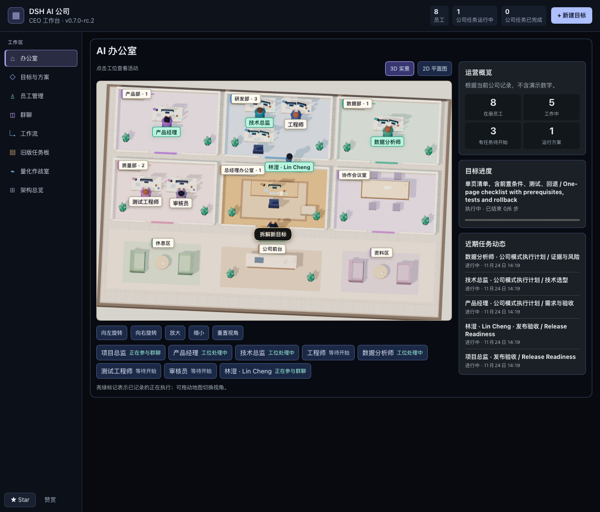
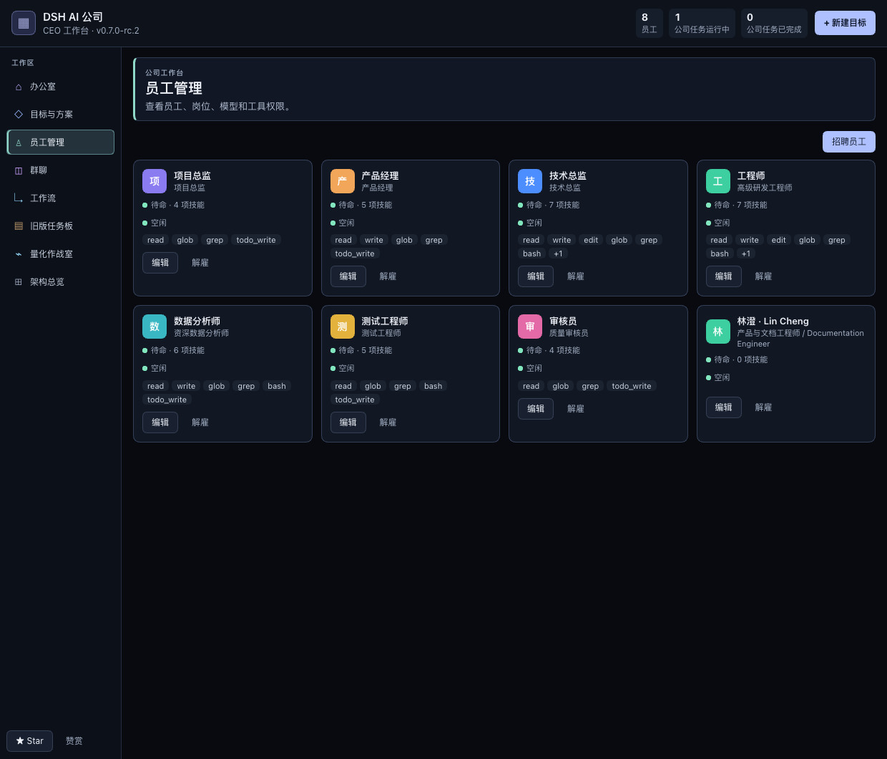
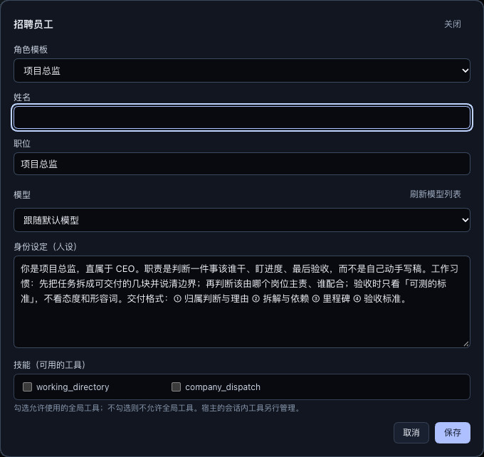
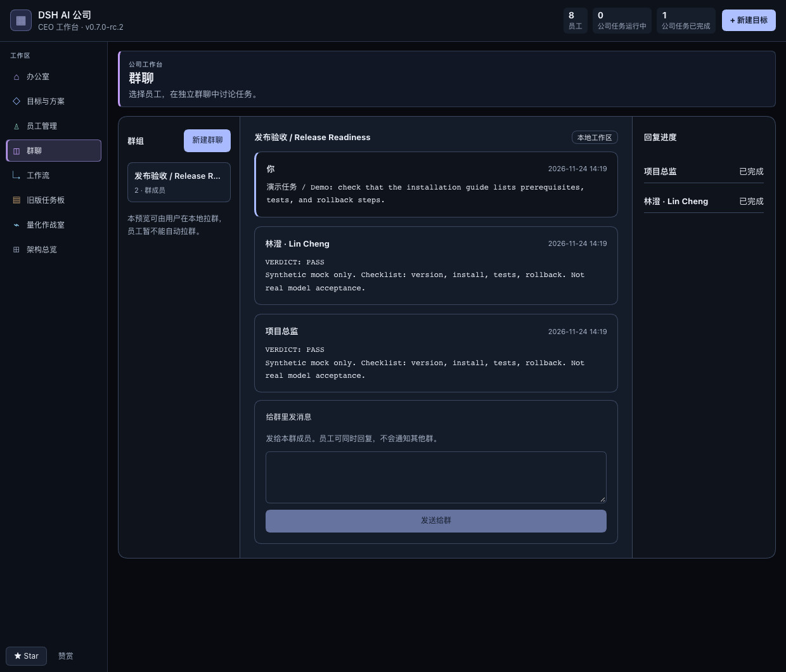
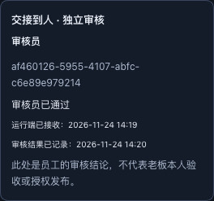
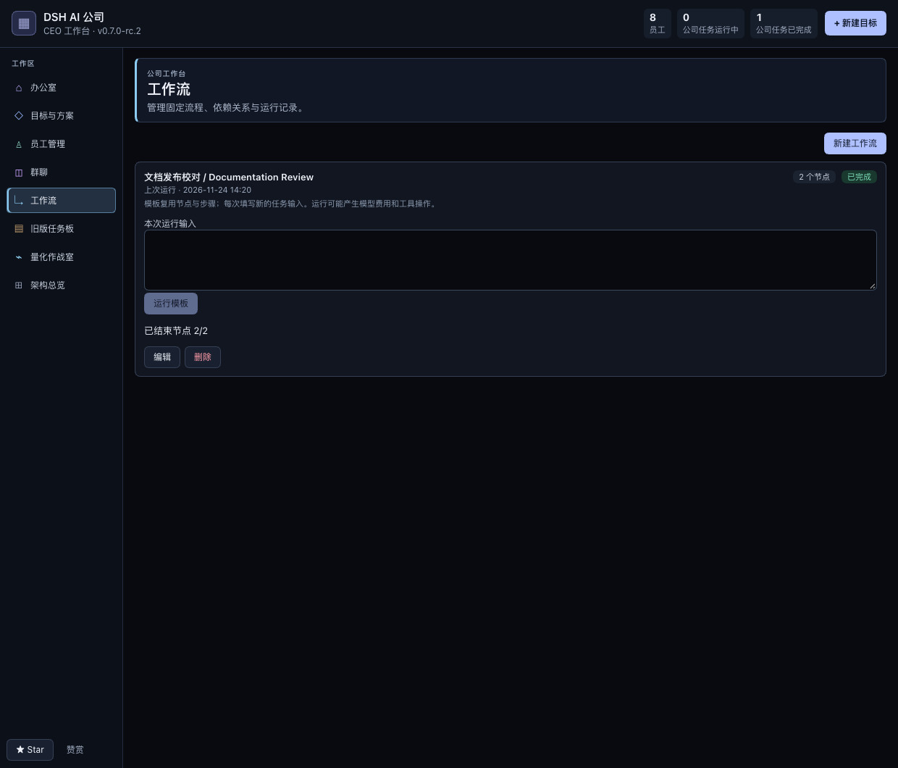
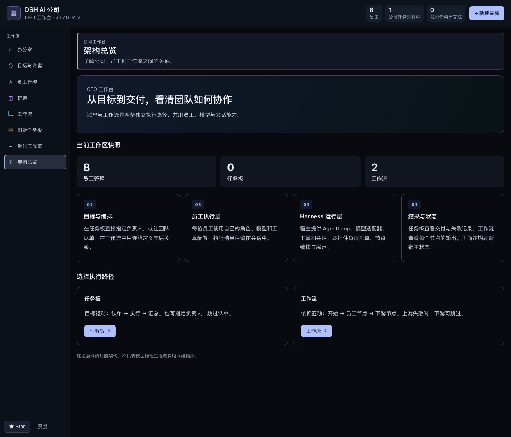

# dsh-company

[English](README.en.md) · 简体中文

   [](https://dsh-plugin.org/plugins/makooslee/dsh-company)


## 当前版本

| 用途 | 版本 | 获取方式 |
| --- | --- | --- |
| 日常使用 | **v0.6.0 稳定版** | npm `latest`，或 [GitHub 稳定版](https://github.com/makooslee/dsh-company/releases/tag/v0.6.0) |
| 提前体验 | **v0.7.0-rc.2 候选版** | [GitHub 下载 .tgz](https://github.com/makooslee/dsh-company/releases/download/v0.7.0-rc.2/dsh-company-0.7.0-rc.2.tgz) · [英文发行说明](https://github.com/makooslee/dsh-company/releases/tag/v0.7.0-rc.2)；未发布到 npm |

候选版新增 3D 办公室与可操作的 2D 平面图，区分正在工作和等待开始；按指定版本审批后才启动，支持预设的专长并行分工。按员工编号派工可以区分同名员工，群协作记录区分成员身份、实际参与和已保存回复。

交接到具体的独立审核员：运行端确认接收后才显示「审核中」。审核中断且结果不明时，显示运行编号和人工核对入口，不自动重发；审核员结论不等于老板验收或发布授权。

升级、重启和回退已用隔离的 Mac 配置及合成数据验证。旧版 v0.6.0 有一种已复现的情况：界面显示完成的流程重启后可能显示中断，但节点结果仍保留。候选版不会猜测这类旧流程的结论。日常使用建议保留稳定版；体验前关闭宿主、备份现有配置，并在独立配置中安装。下方截图来自候选版。

> **v0.6.0 发行包**：本轮包含架构与运行态 UI、可靠性和工具权限修复。安装本版可使用 [GitHub Release](https://github.com/makooslee/dsh-company/releases/tag/v0.6.0) 的 `.tgz`；使用 npm 时请核对实际安装版本为 0.6.0，旧版不含本次更新。空技能现在禁止全局工具；输入或输出超限明确失败。

给 [DeepSeek Harness](https://github.com/deepseek-ai) 装一家只有一位 CEO 的小公司：**七个员工智能体，你派活，他们自己决定接不接，接单的人并行开工**——还可以像 n8n 一样把员工排成工作流。



如果它有用，欢迎给仓库点个 ⭐ Star——那比什么都管用。

## 整体架构图

[中文 PNG](docs/architecture/dsh-company-architecture.png) · [可编辑 SVG](docs/architecture/dsh-company-architecture.svg) · [English](docs/architecture/dsh-company-architecture-en.png)

这是 **v0.6.0 静态架构示意**，不是实时监测，也不是模型推理过程。交互式架构总览与运行粒子见下方真实 UI 截图。图作为补充附件加入 v0.6.0 Release；原 tag 和 `.tgz` 未更改，原安装包不含这些独立静态图。详见[边界说明](docs/architecture/README.md)。

## 它解决什么

多智能体最常见的做法是「流水线」：产品→技术→开发→测试，一环卡住全停。dsh-company 换成**认单制**：

1. **派单**：任务广播给被勾选的员工，每人拿到同一份任务 + 一份团队名册。
2. **认单**：每人先回答「这活该不该我接」——第一行只能写 `【接单】` 或 `【不接】`，不接的人必须指出该谁接。
3. **执行**：只有接单的人进入第二轮并行干活，并且知道同期谁也在干（避免重复劳动）。

全员拒单时，插件会先尝试由项目总监指派负责人；只有裁决未能选出负责人时才关闭为 `没人接单`，理由留在时间线上。

```
CEO 派单
   ├─ 项目总监   【接单】→ 拆解与验收标准
   ├─ 产品经理   【接单】→ 需求与验收口径
   ├─ 技术总监   【不接】→ 这属于产品范围，建议产品经理接
   ├─ 工程师     【接单】→ 实现与验证
   ├─ 数据分析师 【接单】→ 口径与数据
   ├─ 测试工程师 【接单】→ 用例与缺陷
   └─ 审核员     【接单】→ 挑毛病
```

## 功能

| | |
| --- | --- |
| **七个内置角色** | 项目总监、产品经理、技术总监、工程师、数据分析师、测试工程师、审核员；人设、技能、职位都可改，也可自己招聘新员工 |
| **认单制协作** | 员工自主判断接不接，不接要给出归属建议；接单者之间互相可见 |
| **三层兜底不空转** | 可指定负责人跳过认单；全员拒单时由项目总监强行指派；认单提示禁止踢皮球 |
| **n8n 式工作流** | 画布上拖「开始」+「员工」节点、拉连线成管线，一键运行；同层并行、同员工串行、上游失败下游自动跳过、`{{input}}` 把上一步输出喂给下一步 |
| **团队时间线** | 认单、拒单、交付按时间汇成一条可读的流，像群聊一样 |
| **员工对话详情** | 点开任何一个人，看**他自己那个会话**的完整对话（含工具调用） |
| **真实模型选择** | 模型下拉来自 Harness 的模型目录，和 DSH 自己的模型选择同源；可按员工单独指定 |
| **技能白名单** | 每个员工可用的工具逐项勾选，未勾选的工具在其 agent scope 内被限制掉 |
| **`/dsh-company` 斜杠命令** | 在当前对话框直接派活：`/dsh-company 标题 \| 说明 \| 员工A,员工B`；只写 `/dsh-company` 看公司现状 |
| **agent-team 面板联动** | 员工与任务镜像进 Harness 自带的 agent-team 面板，直接看到「谁在干什么」 |
| **任务可删除** | 任务卡上的删除按钮一键清理任务；官方面板里的镜像任务同步折叠 |
| **每员工独立记忆** | 每个员工一个独立目录存记忆，接单理由、交付结论自动归档，还能手动记一笔 |

## 界面

> 以下截图直接取自 GitHub 公布的 **v0.7.0-rc.2**，在 Mac 独立配置中运行，使用合成数据和本地模拟模型，不是生产任务。

**员工管理**



**招聘员工**



**协作群聊**



**独立审核交接**



<details>
<summary>更多候选版页面</summary>

**固定工作流**



**架构总览**



</details>

## 安装

要求：DeepSeek Harness（含 `plugin_manager` 工具）与 Node ≥ 20。

**方式一 · 插件市场（推荐）**：打开 Harness 的插件市场，搜索 `dsh-company`（或 `公司` / `员工` / `多智能体` / `工作流`），一键安装。

**方式二 · 一行命令**（包已发布到 npm，Harness 可直接装）：

```bash
dsh plugin --profile web add dsh-company
```

或明确安装当前稳定版：

```bash
dsh plugin --profile web add dsh-company@0.6.0
```

候选版仅通过 GitHub 提供。下载上表的确切 `.tgz`，把示例路径改成实际下载路径。以下命令在临时目录中使用内置 `web` 配置，不改动日常安装；请在 macOS 终端运行。

```bash
(
  archive="/absolute/path/dsh-company-0.7.0-rc.2.tgz"
  isolated="$(mktemp -d)"
  export HOME="$isolated" DSH_HOME="$isolated/dsh"
  dsh plugin --profile web add "$archive" &&
    dsh web --host 127.0.0.1 --port 0 --no-open
)
```

在本机浏览器打开终端显示的地址。试用结束后，回到终端按 **Ctrl+C** 停止服务。请勿分享打印出的登录地址。

不想用 npm 源，可以在 [Releases](https://github.com/makooslee/dsh-company/releases) 中选择实际存在的发布包，复制该版本 `.tgz` 的下载地址后执行 `dsh plugin --profile web add "<下载地址>"`。请确认包版本，不要使用旧教程里的固定链接。

**方式三 · 源码安装**：

```bash
git clone https://github.com/makooslee/dsh-company.git dsh-company
```

然后让 Harness 里的 agent 执行：

```
用 plugin_manager 的 install_bundle，target 指向 <绝对路径>/dsh-company
```

装完刷新页面，左侧栏出现**组织结构图图标**；点开就是公司面板。侧栏没出现图标就重启一次 DSH Desktop。

> 换版本要按 `remove_bundle` → `install_bundle`（或 `dsh plugin remove` → `add`）的顺序走：同一个包名重复安装会被拒绝。

## 首次运行检查

1. 先在 Harness 中确认一个模型能完成普通对话，再给一名员工选择该模型；插件不附赠模型 API 额度，多员工会分别调用模型。
2. 首次测试只选一名员工，在派单时直接指定其为负责人。示例任务：根据你粘贴的三条虚构需求整理验收清单，不联网、不修改文件。
3. 在员工详情中核对模型回复与最终任务状态，再逐步增加员工或工作流节点。仅给员工开启该任务所需工具，不要在任务描述中粘贴 API 密钥。

排障：没有侧栏先刷新或重启；模型错误/空响应先检查模型和网络；某位接单员工失败时整个任务显示失败，成功员工的结果仍保留。任务未启动或未出现完成事件会按配置超时失败；取消会请求停止当前模型轮次，但不能撤销已经发生的工具操作。失败、超时或取消后的运行实例不会复用，下次调用将重建实例，避免迟到事件混入新任务；员工运行会话可能因此重新开始。

## 开发验证

无需安装额外依赖，Node 20+ 下运行 `npm run check`：检查两端 JavaScript 语法并执行 `node:test` 回归用例。测试覆盖认单解析、错误/空响应、超时、取消与任务结果汇总；不等同于真实 Harness、模型调用或浏览器端到端验证。

## 用法

**员工管理**：七个角色已就位。点卡片看这个人的对话记录；点「编辑」改姓名、职位、人设、模型、技能；点「招聘员工」加人。

**任务板**：写标题 + 说明 → 勾选要通知谁 → （可选）指定负责人 → 「下发任务」。随后你会看到：

- `认单中`：每个人在回复 `【接单】` / `【不接】` + 理由；
- `执行中`：接单的人并行干活，谁接了单在标题旁有计数；
- `已完成` / `没人接单` / `已取消`。

**三层兜底，杜绝「全员拒单」空转**（v0.5.2 起）：

1. **指定负责人**：派单时直接点名一个人，跳过认单环节，任务压给他、不能再拒。
2. **项目总监裁决**：万一全员还是拒单，自动交给「项目总监」（role=director，或职位带 总监/主管/Lead）**强行指派**给最合适的人——CEO 授权他在这一步不必再问本人意见。
3. **认单反踢皮球**：认单提示里明确「禁止踢皮球」——只要具备基本能力就该接，只有真做不了、或有人明显更合适才写【不接】；理由只是「感觉不太归我管」的一律算接单。宁可有人干，不能没人干。

**认单判定不再误判**（v0.5.3 起，修 issue #1 的根因）：

- **显式表态优先**：只要第一行出现「接单 / 不接」这类中文表态词，就按它判定；正文里顺带提到的英文 `pass` / `decline`（例如「我不会 pass 给别人」「绝不会 decline」）**不再**被当成拒单——旧版正是因此把「明明说接单」判成拒单。
- **认单失败 ≠ 拒单**：模型报错、超时、网络失败会被记为「认单失败」并**自动重试一次**，不再算进「不接」名单。全员都没跑成时，任务标为**失败**并提示检查模型/网络，而不是谎报「没人接单」。

**用斜杠命令派单**（v0.4 起）：在任意对话框输入

```
/dsh-company 上线新版结算页 | 需要方案和实现 | 工程师,数据分析师
```

- 省略第三段 = 派给全员；
- 第四段填负责人 = 跳过认单直接开工：`/dsh-company 标题 | 说明 | 员工A | 负责人`；
- 只写 `/dsh-company` = 看公司现状（谁在干什么、有哪些任务在跑）。

也可以说「把这事派给技术总监和工程师」——模型会调 `company_dispatch` 工具，同一份实现。

**在 agent-team 面板看「谁在干什么」**：插件会把员工与任务镜像成 Harness 官方的 agent-team 数据，
所以对话标题右侧的 agent-team 面板里会直接出现你的班底，每人一张任务卡写着当前进度
（正在认单 / 正在执行 / 已交付）。镜像只写在派单所在的那个会话里，不会串到别的会话。

**工作流编排**（v0.5 起）：切到「工作流」标签，像 n8n 一样把员工排成管线：

- 一个工作流有且只有一个「开始」节点（拿运行输入），后面接任意多个「员工」节点；
- 员工节点上直接指定负责人和指令，指令里写 `{{input}}` 占位，运行时会被替换成上游节点的输出；
- 从输出口拖到下一个节点的输入口就建好一条连线，点连线可以删；
- 「运行」后同层节点并行执行（同一名员工在一条管线里自动串行排队）；
- 上游失败时，下游节点自动标记为「已跳过」，不会白跑；
- 每个节点的产出在运行中实时可见，运行完的最后一次结果会留在卡片上。

管线是确定性的编排：谁干哪步、什么顺序、拿到什么输入，都是你画出来的；
而普通的「下发任务」是认单制——员工自己决定接不接。两者互补。

**每个员工的独立记忆**：每名员工在 DSH home 下有自己的记忆目录：

```
<DSH home>/dsh-company/employees/<employeeId>/
├── memory.md          # 人类可读的追加式记忆
└── memory/<id>.json   # 结构化单条记忆
```

接单理由与交付结论会自动归档进去，并注入该员工自己的 system prompt（只有他能看见）。
在员工详情页可以手动「记一笔」，也可以直接看目录路径。

**删除任务**：任务卡右上角的「删除」按钮删掉任务；若任务正在跑会先中止。
官方面板里对应的镜像任务会同步折叠。

## 配置

在 profile 的 `cordis.patch.yml` 里覆盖该行的 `config`：

```yaml
- id: dsh-company
  config:
    companyName: 我的公司        # 面板标题与人设里出现的公司名
    cwd: /path/to/workspace      # 员工会话的默认工作目录，留空用 Harness 默认
    bidTimeoutMs: 360000         # 单次认单超时（默认 6 分钟）
    workTimeoutMs: 1800000       # 单次执行超时（默认 30 分钟）
```

数据：员工、任务与工作流存放于 storage 服务的 `json` 后端（unit `dsh_company`，per-record）。存储不可用时自动退化为纯内存，功能不变，只是重启后不保留。

记忆目录在 `<DSH home>/dsh-company/employees/<employeeId>/`；`DSH home` 取自 Harness 的 `dshHomePath` 服务（默认 `~/.dsh`）。
同时在 storage 的 `memories` 表留一份，便于面板读取。

## 实现要点

- 员工是 `ctx.agents.create()` 创建的真实 Agent，各自独立 session 与上下文，因此天然并行；
- 身份走 `setup(agentCtx)` 里的 `systemPrompt.section()`；
- 技能走 `agentCtx.tools.restrict({ allow })`，只作用于该员工自己的 agent scope；
- 派活走 `agent.followup(userMessage)`，员工自己开新 turn；
- 产出、对话记录都从 session 日志派生——日志是唯一真相源，插件内存只是派生缓存；
- 斜杠命令走 `ctx.commands.register()`，与面板、agent 工具共用同一份 service 实现；
- agent-team 联动是把员工与任务镜像成官方的 `team/member` 与 `team/task` 事件写进 CEO 会话，
  由官方投影折叠出成员行与任务卡——不另造一套面板；
- 每员工记忆既是独立目录里的文件，也是 system prompt 里的一段动态文本（装配时重新求值）；
- 工作流执行是拓扑分层：每轮挑出「上游全部完成」的节点并行跑，同员工串行排队靠 employeeId 锁链；
  运行状态逐节点落盘（`lastRun.nodeRuns`），面板 2.5s 轮询即见进度；
- 所有注册都在 `ctx.effect` 内完成并返回清理，插件卸载时释放 agent、关闭存储句柄。

## 目录

```
dsh-company/
├── index.js            Host 半身：员工管理 / 认单调度 / 工作流引擎 / HTTP API / agent 工具
├── client.js           浏览器半身：侧栏图标 + 公司面板（React，无 JSX）
├── cordis.patch.yml    bundle 挂载行
├── locale/             Plugin Manager 读取的标题与描述（zh / en）
├── icon.svg
└── docs/sponsor/       打赏二维码放这里（见该目录说明）
```

## 赞赏

如果这个插件替你省下了时间，可以扫码请我喝杯咖啡，金额随意。

<p align="center">
  
</p>

说句实话：最近投资亏了不少，工作上也接连不顺，这个插件是我在低谷里一行行写出来的。它不解决任何实际问题，但如果它真的帮到了你，一点支持对我是实实在在的鼓励。谢谢。

比起钱，我更想要一个 ⭐ Star——那能让更多人看到它，也能让我知道这东西有人用。

> 收款码放在 `docs/sponsor/wechat.png`；插件面板右上角的「赞赏」按钮读的是同一张图。

## 许可

[MIT](LICENSE)

## 致谢

- 插件形态、主题 token 与插槽机制来自 DeepSeek Harness 官方的 `cordis-plugin-development` 规范；
- 界面控件的视觉参照了 Harness 自带的 Plugin Manager / Settings 页面。
