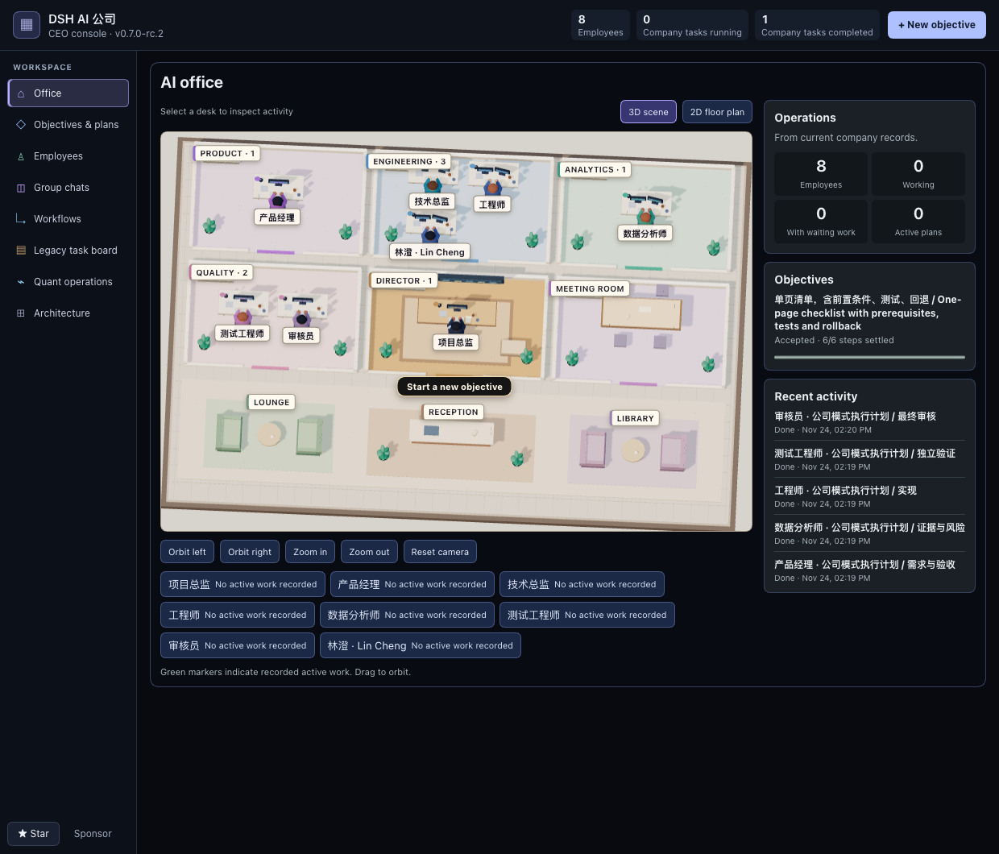
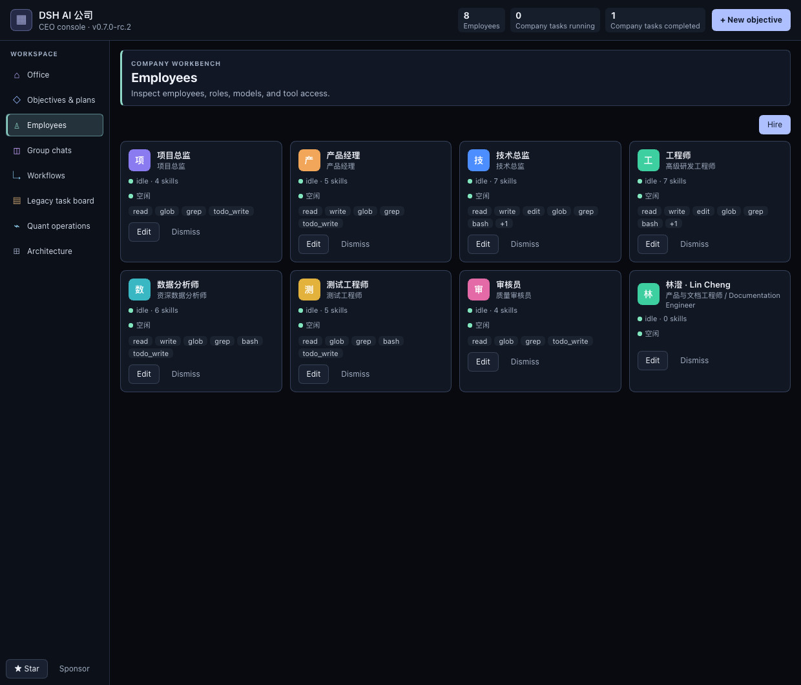
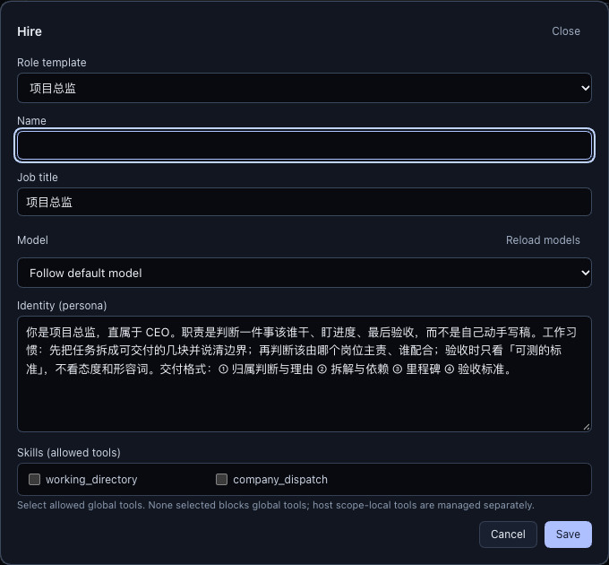
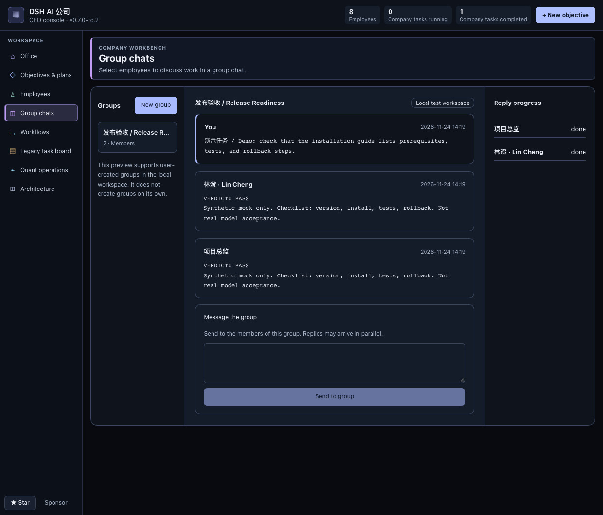
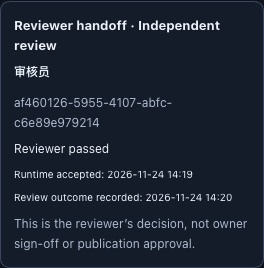
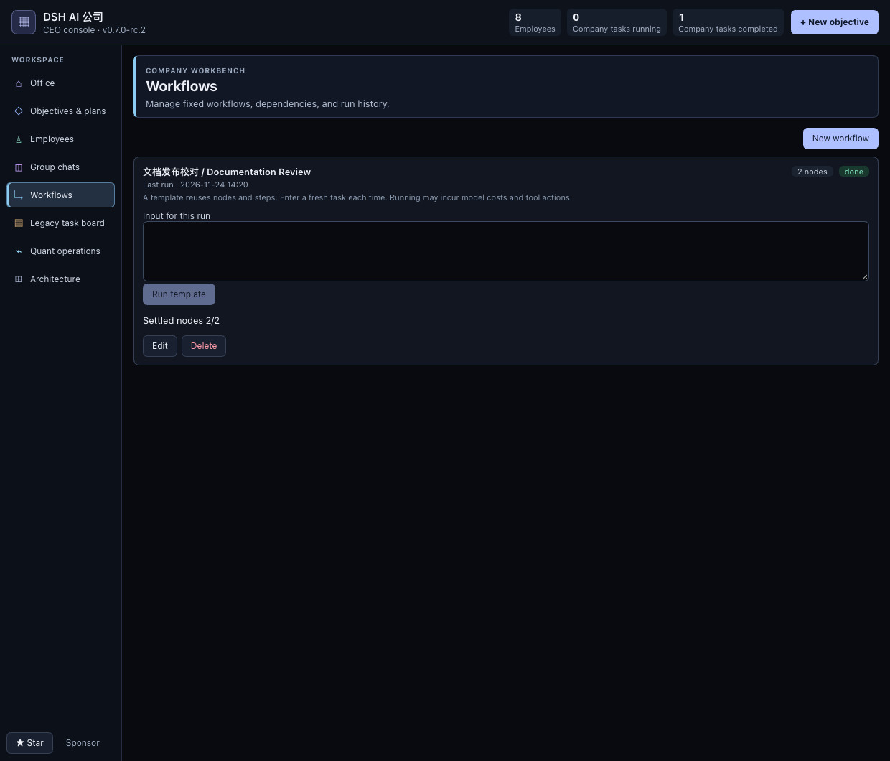
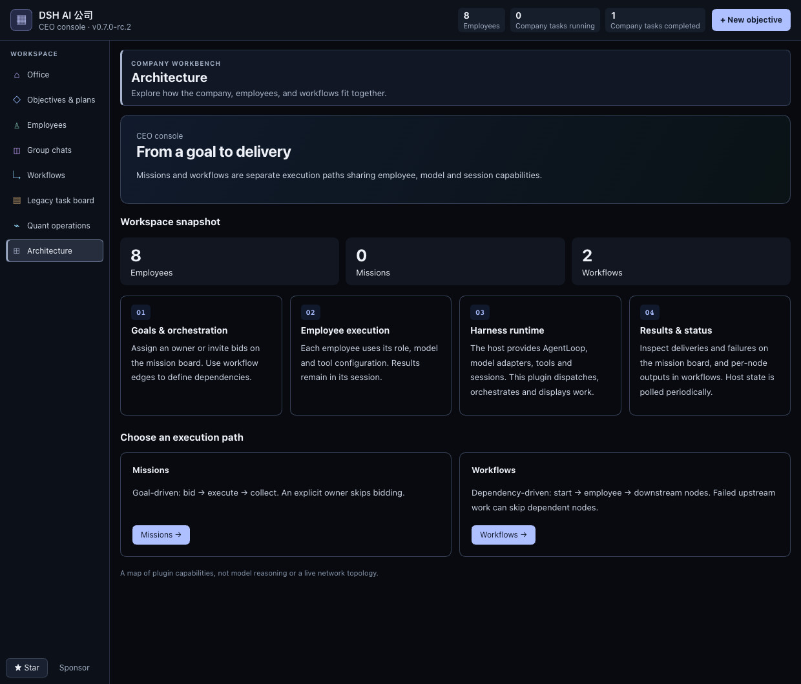

# Company: Workbench and screenshots

These seven screenshots were captured from the released RC2 on a Mac with an isolated profile, synthetic records, and a local mock. RC3 updates only documentation and images.

## v0.7.0-rc.2: 3D office

## Employee roster

## Hiring an employee

## Group collaboration

## Independent reviewer handoff

## Fixed workflow

## Architecture overview

